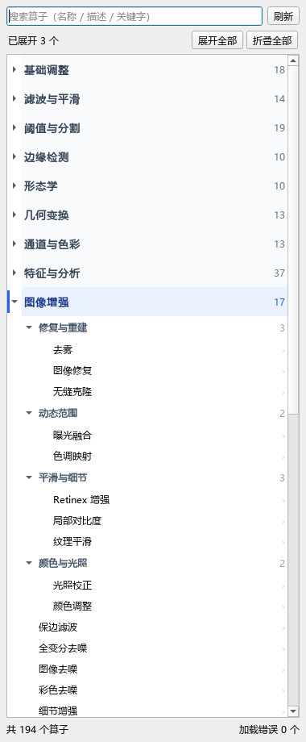

# OpenCV 5.0 算子目录

MineImage 的算子库按 OpenCV 模块组织，目标是让常见图像处理流程可以完全用节点搭出来：从读图、滤波、分割、特征、增强到检测、标定与 DNN 推理。本页由 `scripts/gen_opencv_catalog_doc.py` 从注册表自动生成。



## 1. 规模

* 内置算子总数：**196** 个（目录算子 169 个 + 既有算子 27 个）
* 一级分类：**14** 个，顺序由 `app/core/constants.py` 的 `CATEGORY_ORDER` 决定
* 目录算子统一位于 `app/operators/builtin/catalog/`，一个模块文件可导出多个算子
* 每个目录算子在 L/BGR/BGRA × uint8/uint16/float32 共 7 种代表性输入上做默认参数冒烟

## 2. OpenCV 5.0 模块覆盖

| OpenCV 模块 | 覆盖的能力 | 对应节点 | 状态 |
| --- | --- | --- | --- |
| `core` | 算术 / 位运算 / 归一化 / LUT / DFT / 积分图 / 图像矩 / 统计量 | basic.*、analysis.*（fft、integral、moments）、misc.* | ✅ 主要 |
| `imgproc` | 滤波、形态学、几何变换、阈值、分割、边缘、直方图、轮廓、模板匹配、绘图 | filter.*、morph.*、geom.*、threshold.*、segment.*、edge.*、histogram.*、draw.* | ✅ 主要 |
| `imgcodecs` | 图像编解码 | 由 app/core/imageio.py 与工程文件负责，不作为节点 | ➖ 非节点 |
| `highgui / videoio` | 窗口、摄像头、视频读写 | GUI 已由 PySide6 承担；暂未提供摄像头节点 | ➖ 非节点 |
| `video` | 光流、背景建模、均值漂移 / CamShift、ECC 对齐、目标跟踪 | video.*（10 个） | ✅ 主要 |
| `calib3d` | 棋盘格、畸变校正、立体匹配、单应、全景拼接 | calib.*（6 个） | ✅ 主要 |
| `features2d` | SIFT / ORB / AKAZE / BRISK / KAZE / MSER / FAST / SimpleBlob、角点、匹配 | keypoint.*（12 个）、feature.match、analysis.match_shapes | ✅ 主要 |
| `objdetect` | Haar 人脸、HOG 行人、二维码、条码 | detect.*（4 个） | ✅ 主要 |
| `dnn` | Blob 预处理、通用模型推理 | dnn.blob、dnn.infer（需要模型文件） | 🟡 部分 |
| `ml` | 传统机器学习 | segment.kmeans（K 均值分割） | 🟡 部分 |
| `flann` | 近似最近邻匹配 | feature.match 的 FLANN 匹配器 | ✅ 主要 |
| `photo` | 去噪、修复、无缝克隆、风格化、HDR、色调映射 | enhance.*（17 个） | ✅ 主要 |
| `stitching` | 全景拼接 | calib.panorama | ✅ 单节点 |
| `gapi` | Graph API | 暂未封装；可在后续用图执行器接入 | 🧭 后续 |
| `3d / calib / stereo（5.0 新增模块）` | 多相机标定、点云 / 网格、稠密 RGB-D、立体深度 | calib.stereo_disparity、calib.stereo_depth（基于 4.x/5.0 通用 StereoMatcher） | 🧭 后续（本机 4.12 无 3d/stereo 模块） |

> 说明：OpenCV 5.0 的公共 API 数量以千计，其中大量是底层数据结构、I/O、GPU / HAL、机器学习训练接口，并不适合作为图像节点。本项目采用「语义节点 + 通用调用兜底」的策略：常见图像处理语义逐一封装为节点；其余函数可通过 `misc.cv2_call` 按函数名直接调用（JSON 参数，不执行任意代码），`misc.cv2_info` 用于确认当前 OpenCV 版本与模块可用性。

### 2.1 OpenCV 5.0 迁移说明

* 本机开发环境实测为 opencv-python 4.12.0；目录算子只使用 4.x 与 5.0 都保留的稳定 API，
  切换到 5.0 后无需改代码。
* OpenCV 5.0 新增 `3d` / `calib` / `stereo` 模块，并重构了 DNN 引擎；
  本目录用 `calib.stereo_*` 覆盖立体匹配，`dnn.infer` 覆盖 Net 推理，
  5.0 专有 API 可在 `misc.cv2_call` 中直接调用。
* OpenCV 5.0 支持关键字参数调用；`misc.cv2_call` 同时支持位置参数（JSON 数组）
  与关键字参数（JSON 对象），方便跟随 5.0 的调用习惯。

## 3. 分类清单

下表只统计目录算子；加上既有 27 个算子后的总数见第 1 节。

| 一级分类 | 算子数 |
| --- | --- |
| 基础调整 | 14 |
| 滤波与平滑 | 11 |
| 阈值与分割 | 17 |
| 边缘检测 | 8 |
| 形态学 | 6 |
| 几何变换 | 10 |
| 通道与色彩 | 11 |
| 特征与分析 | 32 |
| 图像增强 | 17 |
| 视频与运动 | 10 |
| 立体与标定 | 6 |
| 深度学习 | 6 |
| 交互处理 | 17 |
| 其他 | 4 |

## 4. 算子明细

### 基础调整（14）

| id | 名称 | 子分类 | 说明 |
| --- | --- | --- | --- |
| `basic.absdiff` | 绝对差分 | 算术 | 求图像与第二幅图像的逐像素绝对差；第二幅图未连接时求与参数常数值的绝对差。常用作运动检… |
| `basic.add` | 加法 | 算术 | 把图像与第二幅图像逐像素相加；第二幅图未连接时改为加上参数常数值。结果按整型饱和裁剪，… |
| `basic.add_weighted` | 加权叠加 | 算术 | 按 alpha / beta / gamma 对两幅图像做加权和；第二幅图未连接时等价… |
| `basic.bitwise_and` | 按位与 | 算术 | 对图像与第二幅图（或参数常量）做逐位与。整型按原生位宽运算，float32 先转 8 … |
| `basic.bitwise_not` | 按位取反 | 算术 | 对每个像素按位取反。uint8 等价于 255 - 像素，uint16 等价于 655… |
| `basic.bitwise_or` | 按位或 | 算术 | 对图像与第二幅图（或参数常量）做逐位或。整型按原生位宽运算，float32 先转 8 … |
| `basic.bitwise_xor` | 按位异或 | 算术 | 对图像与第二幅图（或参数常量）做逐位异或。整型按原生位宽运算，float32 先转 8… |
| `basic.compare` | 图像比较 | 算术 | 把图像与第二幅图（或参数常数值）逐像素比较，输出单通道二值掩膜（满足为 255）。彩色… |
| `basic.convert_scale` | 线性缩放 | 算术 | 按“像素 × alpha + beta”做线性映射，可选输出绝对值（类似 conver… |
| `basic.divide` | 除法 | 算术 | 把图像逐像素除以第二幅图像；第二幅图未连接时改为除以参数系数。分母会被钳制到极小值，避… |
| `basic.gamma` | 伽马校正 | 算术 | 按 out = in^(1/γ) 做逐像素伽马校正：γ 大于 1 提亮中间调，小于 1… |
| `basic.multiply` | 乘法 | 算术 | 把图像与第二幅图像按 0..1 归一化后逐像素相乘；第二幅图未连接时改为乘以参数系数。… |
| `basic.normalize` | 归一化 | 算术 | 把整幅图像的像素按最小 / 最大值拉伸到指定区间。常数图像输出该区间下限；输出 dty… |
| `basic.subtract` | 减法 | 算术 | 从图像中减去第二幅图像；第二幅图未连接时改为减去参数常数值。结果小于 0 的部分按整型… |

### 滤波与平滑（11）

| id | 名称 | 子分类 | 说明 |
| --- | --- | --- | --- |
| `filter.bilateral` | 双边滤波 | — | 同时考虑空间距离与颜色差异的双边滤波，平滑噪声的同时保留边缘。uint16 / flo… |
| `filter.box` | 方框滤波 | — | 用矩形邻域做方框滤波。归一化时为均值模糊；关闭归一化则输出邻域和，适合观察局部能量。u… |
| `filter.filter2d` | 自定义卷积 | — | 用内置预设卷积核做二维卷积：锐化、边缘、浮雕或邻域平均。强度会整体缩放卷积核，默认 1… |
| `filter.laplacian` | 拉普拉斯滤波 | — | 用拉普拉斯算子提取二阶边缘响应，并取绝对值方便显示。核大小 1/3/5/7 可选；对全… |
| `filter.pyr_mean_shift` | 均值漂移滤波 | — | 金字塔均值漂移滤波，把颜色相近的邻域收敛到同一颜色，产生绘画般的平滑效果。该 Open… |
| `filter.pyrdown` | 金字塔下采样 | — | 先用高斯核平滑再去掉偶数行/列，得到宽高各约一半的图像。输出宽高为 ceil(宽/2)… |
| `filter.pyrup` | 金字塔上采样 | — | 在偶数行/列之间插入零并做高斯平滑，得到宽高约两倍的图像。输出为输入的 2 倍尺寸，保… |
| `filter.sep_filter` | 可分离卷积 | — | 用两个一维高斯核分别沿 X/Y 方向做可分离卷积，速度优于同等二维核。sigma 为 … |
| `filter.sharpen` | 锐化 | — | 用中心加权卷积核增强边缘对比度。强度越大中心权重越高；对 uint8/uint16/f… |
| `filter.sqr_box` | 平方方框滤波 | — | 先对邻域像素平方求均值，再开方得到均方根强度，适合观察局部能量分布。结果会裁剪回输入 … |
| `filter.unsharp` | 非锐化掩模 | — | 用高斯模糊构造低频层，再把原图与低频层的差值按强度加回，得到可调的非锐化掩模锐化。阈值… |

### 阈值与分割（17）

| id | 名称 | 子分类 | 说明 |
| --- | --- | --- | --- |
| `segment.approx_poly` | 多边形逼近 | 分割 | 用 Douglas-Peucker 算法把轮廓逼近成更少顶点的多边形。逼近精度按轮廓周… |
| `segment.components` | 连通域标记 | 分割 | 先二值化，再用 connectedComponentsWithStats 标记连通域，… |
| `segment.contours` | 轮廓提取 | 分割 | 二值化后查找轮廓，按最小面积过滤，再把轮廓绘制到彩色图上。输出绘制结果、轮廓点集与轮廓… |
| `segment.convex_hull` | 轮廓凸包 | 分割 | 提取轮廓后计算每个轮廓的凸包，并绘制到彩色图上。输出凸包标注图、凸包点集与数量。 |
| `segment.distance` | 距离变换 | 分割 | 先把图像二值化，再计算每个前景像素到最近背景像素的距离（L1 / L2 / 棋盘）。输… |
| `segment.fit_ellipse` | 椭圆拟合 | 分割 | 用最小二乘法为每个轮廓（至少 5 个点）拟合椭圆并绘制。输出椭圆标注图、椭圆轮廓点集与… |
| `segment.floodfill` | 漫水填充 | 分割 | 从种子点开始把颜色相近的连通区域填充成指定颜色。种子点留空时使用图像中心点；可连接可选… |
| `segment.grabcut` | GrabCut 前景分割 | 分割 | 用 GrabCut 图割算法分离前景与背景。默认在图像中心取矩形作为初始前景区域；也可… |
| `segment.kmeans` | K 均值分割 | 分割 | 把每个像素的 BGR 颜色作为三维特征做 K 均值聚类，用聚类中心替换像素颜色，得到色… |
| `segment.min_area_rect` | 最小外接矩形 | 分割 | 为每个轮廓计算最小外接旋转矩形（可倾斜），并绘制到彩色图上。输出矩形标注图、矩形四角点… |
| `segment.watershed` | 分水岭分割 | 分割 | 先把图像二值化，再用距离变换的局部峰值作为前景种子，最后用分水岭算法把粘连目标分开。可… |
| `threshold.adaptive_advanced` | 局部阈值（高级） | 阈值 | 用自适应阈值处理光照不均的图像：均值或高斯加权计算每个像素的局部阈值。内部统一转成 8… |
| `threshold.otsu` | Otsu 自动阈值 | 阈值 | 用 Otsu 大津法按灰度直方图自动求最佳阈值并二值化。内部统一转成 8 位灰度图，因… |
| `threshold.range` | 区间阈值 | 阈值 | 用 inRange 保留灰度落在下限与上限之间的像素，输出 0/255 掩膜与覆盖率。… |
| `threshold.tozero` | 置零阈值 | 阈值 | 低于阈值的像素置零（或反向：高于阈值的像素置零），其余像素保持原值。阈值使用 0-25… |
| `threshold.triangle` | Triangle 自动阈值 | 阈值 | 用 Triangle（三角）法自动求阈值，适合直方图只有一个明显峰值的偏态图像。内部统… |
| `threshold.trunc` | 截断阈值 | 阈值 | 把高于阈值的像素直接截断到阈值，低于阈值的像素保持不变。阈值使用 0-255 通用刻度… |

### 边缘检测（8）

| id | 名称 | 子分类 | 说明 |
| --- | --- | --- | --- |
| `edge.canny_auto` | Canny 自动阈值 | 高级 | 用图像灰度中位数自动确定 Canny 的高低阈值（下界 = (1-σ)×中位数，上界 … |
| `edge.gradient_mag` | 梯度幅值与方向 | 高级 | 用 Sobel 算子计算 x / y 方向梯度，输出归一化的梯度幅值图、方向角编码图（… |
| `edge.hough_circles` | 霍夫圆检测 | 高级 | 用霍夫梯度法（HoughCircles）检测圆形目标，并在彩色图上绘制圆。输出标注图、… |
| `edge.hough_lines` | 霍夫直线 | 高级 | 先做 Canny 边缘检测，再用标准霍夫变换（HoughLines）提取无限长直线，并… |
| `edge.hough_lines_p` | 概率霍夫线段 | 高级 | 先做 Canny 边缘检测，再用概率霍夫变换（HoughLinesP）提取有端点的线段… |
| `edge.laplacian` | Laplacian 边缘 | 高级 | 用 Laplacian 二阶微分检测边缘与细节，输出取绝对值并归一化到 0-255 的… |
| `edge.lsd` | LSD 线段检测 | 高级 | 用 LSD（Line Segment Detector）在灰度图上直接检测直线段，不需… |
| `edge.scharr` | Scharr 梯度 | 高级 | 用 Scharr 算子计算 x / y 方向梯度，输出归一化到 0-255 的梯度幅值… |

### 形态学（6）

| id | 名称 | 子分类 | 说明 |
| --- | --- | --- | --- |
| `morph.blackhat` | 黑帽变换 | — | 闭运算结果减去原图，提取比结构元素更小的暗细节，例如小暗点与细暗线。对彩色图像按通道独… |
| `morph.ex` | 通用形态学 | — | 在一个算子内选择腐蚀、膨胀、开/闭运算、梯度、顶帽或黑帽。可选蒙版输入：蒙版为 0 的… |
| `morph.gradient` | 形态学梯度 | — | 用膨胀图减腐蚀图得到形态学梯度，突出亮度变化剧烈的边缘。结果始终非负；支持 L/BGR… |
| `morph.hitmiss` | 击中击不中 | — | 把输入转为 8 位二值图，用环形结构元素做击中击不中变换，检测孤立的前景亮点（或按需检… |
| `morph.kernel` | 结构元素预览 | — | 把矩形 / 椭圆 / 十字结构元素放大成像素块并生成预览图，右侧标注核形状、尺寸、前景… |
| `morph.tophat` | 顶帽变换 | — | 原图减去开运算结果，提取比结构元素更小的亮细节，例如小亮点与细亮线。对彩色图像按通道独… |

### 几何变换（10）

| id | 名称 | 子分类 | 说明 |
| --- | --- | --- | --- |
| `geom.crop` | 区域裁剪 | — | 按 ROI 矩形 [x, y, w, h] 裁剪图像并自动夹取到图像范围内。未框选时默… |
| `geom.pad` | 边界填充 | — | 在上下左右按像素扩充画布，可选择常量（黑）、复制边缘或镜像等填充方式。常用于给滤波/形… |
| `geom.polar` | 极坐标变换 | — | 把笛卡尔图像映射到极坐标（角度/半径），或把极坐标图还原为直角坐标。线性模式输出 半径… |
| `geom.remap` | 非线性重映射 | — | 用逐像素坐标映射制造波浪、涟漪、漩涡或鱼眼畸变。振幅控制形变强度，频率控制波纹疏密；输… |
| `geom.rotate90` | 正交旋转 | — | 按 90 度的整数倍旋转图像，不产生插值误差。90/270 度时宽高互换；对全部颜色空… |
| `geom.shear` | 错切变换 | — | 沿水平或垂直方向做错切，产生斜切/倾斜效果。X 方向错切按行偏移，Y 方向错切按列偏移… |
| `geom.tile` | 图像平铺 | — | 按行列数把输入图像平铺成网格大图，常用于制作纹理或对比阵列。输出尺寸为 宽×列数 与 … |
| `geom.transpose` | 转置 | — | 沿主对角线转置图像，等价于 x/y 坐标互换，宽高会互换。对全部颜色空间与 dtype… |
| `geom.warp_affine` | 仿射变换 | — | 围绕图像中心做旋转与等比缩放，再按像素做水平/垂直平移。默认参数为恒等变换；输出尺寸与… |
| `geom.warp_perspective` | 透视变换 | — | 把 source 参数中的四个源点映射到整幅输出画面的四角，适合文档/标定板透视校正。… |

### 通道与色彩（11）

| id | 名称 | 子分类 | 说明 |
| --- | --- | --- | --- |
| `color.alpha_composite` | Alpha 合成 | — | 把第二幅图像按 alpha 叠加到第一幅图上：第二幅为 BGRA 时使用其透明通道，否… |
| `color.cvt` | 颜色空间转换 | — | 把图像转换到指定颜色空间。灰度为单通道输出；BGR / RGB 保持输入 dtype；… |
| `color.extract_alpha` | 提取 Alpha | — | 输出 BGRA 图像的透明通道；对没有 alpha 的灰度 / BGR 图像输出全不透… |
| `color.hsv_adjust` | HSV 调整 | — | 在 HSV 空间分别调整色相、饱和度和明度，再转回 BGR。色相按 0..180 环形… |
| `color.lut_curve` | 曲线映射 | — | 用预设曲线或自定义控制点生成 256 级查找表，再映射整幅图像。uint8 走 Ope… |
| `color.mix` | 通道混合 | — | 用 3×3 权重矩阵把输入的 B / G / R 重新组合成输出的 B / G / R… |
| `color.palette` | 伪彩色 | — | 把灰度（或彩色图像的亮度）按指定色图映射为伪彩色，输出 BGR 三通道图像。适合热力图… |
| `color.set_alpha` | 设置 Alpha | — | 把图像转换为 BGRA 并把透明通道统一设置为指定值；灰度 / BGR 输入会自动补 … |
| `color.swap` | 通道交换 | — | 按指定顺序重排 B / G / R 三个通道，例如把 BGR 变成 RGB。BGRA … |
| `color.temperature` | 色温 | — | 模拟色温变化：正值偏暖（增强红、削弱蓝），负值偏冷。调整在 0..1 单位域完成，保持… |
| `color.white_balance` | 白平衡 | — | 按灰度世界假设估计每个通道的增益，把偏色图像的通道均值拉平。“强度”控制校正力度；灰度… |

### 特征与分析（32）

| id | 名称 | 子分类 | 说明 |
| --- | --- | --- | --- |
| `keypoint.akaze` | AKAZE 关键点 | 关键点 | 用 AKAZE（加速的 KAZE）检测非线性尺度空间关键点，在保持稳定性的同时速度接近… |
| `keypoint.blob` | 斑点检测 | 关键点 | 用 SimpleBlobDetector 检测斑点：先按多阈值二值化，再按面积、圆度、… |
| `keypoint.brisk` | BRISK 关键点 | 关键点 | 用 BRISK（Binary Robust Invariant Scalable Ke… |
| `keypoint.corner_harris` | Harris 角点 | 关键点 | 用 Harris 响应函数检测角点：先计算响应图，再按响应峰值的比例做阈值，最后做 3… |
| `keypoint.corner_min_eigen` | 最小特征值角点 | 关键点 | 用结构张量的最小特征值（Shi-Tomasi 响应）检测角点：响应越大说明两个方向的梯… |
| `keypoint.draw` | 关键点绘制 | 关键点 | 用选定的检测器（FAST / ORB / SIFT / AKAZE / BRISK /… |
| `keypoint.fast` | FAST 角点 | 关键点 | 用 FAST（Features from Accelerated Segment Te… |
| `keypoint.good_features` | 优质角点 | 关键点 | 用 goodFeaturesToTrack 检测最优质的角点：可以按质量阈值、点间距与… |
| `keypoint.kaze` | KAZE 关键点 | 关键点 | 用 KAZE 在非线性尺度空间中检测关键点，对模糊和缩放更稳健，但速度比 AKAZE … |
| `keypoint.mser` | MSER 区域 | 关键点 | 用 MSER（Maximally Stable Extremal Regions）检测… |
| `keypoint.orb` | ORB 关键点 | 关键点 | 用 ORB（Oriented FAST and Rotated BRIEF）检测关键点… |
| `keypoint.sift` | SIFT 关键点 | 关键点 | 用 SIFT（尺度不变特征变换）检测尺度与旋转不变的关键点，对缩放、旋转和光照变化都比… |
| `analysis.match_shapes` | 形状匹配 | 匹配 | 对两幅图分别做 Otsu 二值化并取面积最大的外轮廓，用 cv2.matchShape… |
| `analysis.template_match` | 模板匹配 | 匹配 | 在输入图像中搜索模板最相似的位置并画出匹配框。模板端口可选，未连接时自动从图像中心裁剪… |
| `feature.match` | 特征匹配 | 匹配 | 在两幅图像上提取 SIFT / ORB / AKAZE / BRISK 特征，用 BF… |
| `analysis.mean_std` | 均值与标准差 | 度量 | 统计灰度图的均值与标准差，并把每个像素与均值的偏差渲染成热力图，便于观察整体亮度与离散… |
| `analysis.min_max` | 最值定位 | 度量 | 统计灰度图的最小值、最大值及其坐标，并在画面上用圆形标记标出这两个位置。最小值与最大值… |
| `analysis.psnr` | 峰值信噪比（PSNR） | 度量 | 计算两幅图的均方误差与峰值信噪比（PSNR），并把差异渲染成热力图。两幅图完全相同时 … |
| `analysis.ssim` | 结构相似度（SSIM） | 度量 | 用高斯加权滑动窗口计算两幅灰度图的结构相似度（SSIM）图与平均值，SSIM 越接近 … |
| `analysis.backproject` | 直方图反投影 | 直方图 | 用矩形区域内的颜色直方图做反投影，高亮整幅图中与区域颜色相近的像素。彩色图使用 H-S… |
| `analysis.clahe` | CLAHE 均衡 | 直方图 | 用限制对比度的自适应直方图均衡（CLAHE）增强局部对比度。彩色图默认只处理亮度通道；… |
| `analysis.equalize` | 直方图均衡 | 直方图 | 用累计分布做直方图均衡，拉伸低对比度图像。灰度图直接均衡；彩色图默认均衡亮度，也可选择… |
| `analysis.hist_2d` | 二维直方图 | 直方图 | 统计两个通道的联合分布并渲染成彩色热力图，输出 BGR 预览图。H-S 组合适合分析颜… |
| `analysis.hist_compare` | 直方图比较 | 直方图 | 比较两幅灰度直方图的相似程度，输出“对比图”和“相似度”两个结果。第二幅图未连接时与第… |
| `analysis.histogram` | 直方图 | 直方图 | 统计灰度或指定颜色通道的像素分布，并绘制成 480×300 的直方图预览。柱数越多曲线… |
| `analysis.match_hist` | 直方图匹配 | 直方图 | 把图像的直方图变换到参考图像的分布；参考图未连接时使用均匀分布（等价于均衡化）。彩色图… |
| `analysis.hu_moments` | Hu 不变矩 | 矩 | 计算 7 个 Hu 不变矩（对平移、旋转、缩放不敏感），并渲染成文本面板。Hu 矩数值… |
| `analysis.moments` | 图像矩与质心 | 矩 | 计算灰度图的零阶矩、一阶矩与质心，并在画面上用十字标记标出质心位置。零阶矩为像素值之和… |
| `analysis.integral` | 积分图 | 积分 | 计算灰度图的积分图（累加和），并用对数拉伸后渲染成热力图，便于观察亮度在空间上的累积分… |
| `analysis.fft` | 傅里叶变换（FFT） | 频域 | 把灰度图转换为 float32，做二维离散傅里叶变换，输出频谱热力图、频谱总能量，以及… |
| `analysis.ifft` | 逆傅里叶变换（IFFT） | 频域 | 优先使用 spectrum 端口输入的复频谱（来自“傅里叶变换（FFT）”的复频谱输出… |
| `analysis.phase_correlate` | 相位相关位移 | 频域 | 用相位相关（phaseCorrelate）估计两幅图之间的整像素平移，并同时渲染归一化… |

### 图像增强（17）

| id | 名称 | 子分类 | 说明 |
| --- | --- | --- | --- |
| `enhance.denoise` | 图像去噪 | — | 按所选方法去除图像噪点：非局部均值适合高斯噪声，中值滤波适合椒盐噪声，高斯模糊适合快速… |
| `enhance.denoise_color` | 彩色去噪 | — | 使用彩色非局部均值（fastNlMeansDenoisingColored）同时利用亮… |
| `enhance.denoise_tvl1` | 全变分去噪 | — | 用 TV-L1 全变分模型在保边的前提下抑制噪声，适合去除小幅随机噪声。OpenCV … |
| `enhance.detail` | 细节增强 | — | 用高斯低频层构造高频细节并加回原图，提升纹理清晰度。可连接“细节参考图”从另一幅图像提… |
| `enhance.edge_preserving` | 保边滤波 | — | 在平滑颜色的同时保持边缘锐利，常用于人像/绘画风格预处理。OpenCV 接口只支持 8… |
| `enhance.pencil_sketch` | 铅笔素描 | — | 把图像转换为铅笔素描风格，输出单通道灰度线稿。OpenCV 接口只支持 8 位三通道，… |
| `enhance.stylization` | 风格化 | — | 用保边滤波与边缘处理生成类似油画/水彩的平滑风格化效果。OpenCV 接口只支持 8 … |
| `enhance.dehaze` | 去雾 | 修复与重建 | 基于暗通道先验估计大气光与透射率，恢复被雾、霾或烟尘降低的对比度。强度为 0 时输出原… |
| `enhance.inpaint` | 图像修复 | 修复与重建 | 用 Telea 或 Navier-Stokes 算法按蒙版修复图像：蒙版中的白色像素会… |
| `enhance.seamless_clone` | 无缝克隆 | 修复与重建 | 把克隆源图像在矩形区域内的内容无缝融合到当前图像，自动匹配周围色调与边缘。未连接克隆源… |
| `enhance.hdr_merge` | 曝光融合 | 动态范围 | 用 Mertens 曝光融合合并两幅不同曝光的图像，兼顾亮部与暗部细节。未连接第二幅图… |
| `enhance.tonemap` | 色调映射 | 动态范围 | 用 Reinhard 算子压缩高动态范围图像的亮度，保留亮部层次并减少过曝。适合对归一… |
| `enhance.local_contrast` | 局部对比度 | 平滑与细节 | 用限制对比度的自适应直方图均衡（CLAHE）增强局部对比度。彩色图像在 LAB 亮度通… |
| `enhance.retinex` | Retinex 增强 | 平滑与细节 | 用 Retinex 理论分离照射分量与反射分量，提升暗部细节和整体动态范围。单尺度适合… |
| `enhance.texture_flatten` | 纹理平滑 | 平滑与细节 | 使用双边滤波压平皮肤、织物等细碎纹理，同时保留明显边缘。可多次迭代，次数越多越平滑。 |
| `enhance.color_change` | 颜色调整 | 颜色与光照 | 在 HSV 空间调整色相与饱和度，并把画面整体向指定颜色染色，用于风格化或突出主体。染… |
| `enhance.illumination` | 光照校正 | 颜色与光照 | 用大尺度高斯模糊估计低频光照背景，再用原图除以背景并拉回整体亮度，用于校正不均匀照明与… |

### 视频与运动（10）

| id | 名称 | 子分类 | 说明 |
| --- | --- | --- | --- |
| `video.camshift` | CAMShift 跟踪 | 目标跟踪 | 连续自适应均值漂移（CAMShift）在色调反向投影上迭代，得到带旋转角度的目标窗口。… |
| `video.mean_shift` | 均值漂移跟踪 | 目标跟踪 | 用色调直方图反向投影 + 均值漂移（meanShift）迭代定位目标窗口。初始窗口取 … |
| `video.tracker` | 目标跟踪（MIL） | 目标跟踪 | 用 OpenCV 的 MIL（多示例学习）跟踪器在第一帧初始化目标窗口，在第二帧上定位… |
| `video.background_knn` | KNN 背景建模 | 背景建模 | 用 K 近邻（KNN）背景减除器建立背景并提取前景蒙版。第一帧用于建模，第二帧得到前景… |
| `video.background_mog2` | MOG2 背景建模 | 背景建模 | 用高斯混合模型（MOG2）建立背景并提取前景蒙版。第一帧用于建模，第二帧得到前景结果；… |
| `video.frame_diff` | 帧差检测 | 运动检测 | 对两帧图像做逐像素绝对差并放大显示，用于快速定位画面中发生变化的区域。未连接第二帧时自… |
| `video.motion_energy` | 运动能量图 | 运动检测 | 对两帧做帧差、平滑并阈值化，得到运动区域的能量图，再渲染为热力图。未连接第二帧时自动平… |
| `video.optical_flow_farneback` | 稠密光流（Farneback） | 运动检测 | 用 Farneback 多项式展开法计算两帧之间的稠密光流，并渲染成 HSV 色轮图：… |
| `video.optical_flow_lk` | 稀疏光流（Lucas-Kanade） | 运动检测 | 先用 Shi-Tomasi 角点提取特征点，再用 Lucas-Kanade 金字塔光流… |
| `video.ecc_align` | ECC 图像配准 | 配准对齐 | 用增强相关系数（ECC）估计两幅图之间的几何变换，并对第一幅图做逆变换对齐。支持平移 … |

### 立体与标定（6）

| id | 名称 | 子分类 | 说明 |
| --- | --- | --- | --- |
| `calib.homography` | 单应变换 | 拼接与变换 | 对图像施加透视（单应）变换。未连接第二幅图时按「上边缘收拢比例」生成梯形透视；连接第二… |
| `calib.panorama` | 全景拼接 | 拼接与变换 | 用 ORB 特征匹配 + RANSAC 单应矩阵把第二幅图对齐到第一幅图的画布上拼接成… |
| `calib.chessboard` | 棋盘格角点 | 标定 | 在灰度图上检测棋盘格内角点并绘制出来，可选亚像素精化。内角点数量即棋盘格每行 / 每列… |
| `calib.undistort` | 镜头畸变校正 | 标定 | 按径向畸变系数 k1 / k2 与等效焦距构造相机内参，生成校正映射并重采样图像。等效… |
| `calib.stereo_depth` | 立体深度图 | 立体视觉 | 用 StereoSGBM 计算视差，再按 Z = f × baseline / dis… |
| `calib.stereo_disparity` | 立体视差 | 立体视觉 | 用 StereoBM 计算左右视图的视差图并渲染为热力图。视差范围与匹配块大小会按图像… |

### 深度学习（6）

| id | 名称 | 子分类 | 说明 |
| --- | --- | --- | --- |
| `dnn.blob` | DNN 预处理（Blob） | DNN | 执行与 cv2.dnn.blobFromImage 一致的预处理：缩放到指定尺寸、减均… |
| `dnn.infer` | DNN 推理 | DNN | 加载 ONNX / Caffe / TensorFlow 等模型文件，按统一参数生成 … |
| `detect.barcode` | 条码识别 | 目标检测 | 用 OpenCV 的 BarcodeDetector 定位并解码一维条码，画出条码四边… |
| `detect.face` | 人脸检测（YuNet / Haar） | 目标检测 | 用 OpenCV Zoo 的 YuNet ONNX 模型检测正面人脸，并在画面上画出人… |
| `detect.hog_people` | 行人检测（HOG） | 目标检测 | 用 HOG + SVM 默认行人检测器扫描图像，输出带行人框的标注图与人数。检测器要求… |
| `detect.qr` | 二维码识别 | 目标检测 | 用 OpenCV 的 QRCodeDetector 定位并解码二维码，在画面上画出二维… |

### 交互处理（17）

| id | 名称 | 子分类 | 说明 |
| --- | --- | --- | --- |
| `draw.circle` | 绘制圆形 | 基础图形 | 在图像上绘制圆形边框或实心圆，用于圈选目标。未指定区域时以图像中心为圆心、短边的一半为… |
| `draw.ellipse` | 绘制椭圆 | 基础图形 | 在图像上绘制椭圆边框或实心椭圆，可设置旋转角度。未指定区域时使用图像中心 50% 区域… |
| `draw.polygon` | 绘制多边形 | 基础图形 | 按点集绘制闭合多边形或实心多边形，可交互拾取任意数量的顶点。未指定点集时在图像中心生成… |
| `draw.rectangle` | 绘制矩形 | 基础图形 | 在图像上绘制矩形边框或实心矩形，用于框选目标或强调区域。未指定区域时使用图像中心 50… |
| `layout.border` | 添加边框 | 布局与对比 | 在图像四周添加指定宽度与颜色的边框，可选用双层边框样式，适合排版拼图或做展示留白。 |
| `layout.contact_sheet` | 缩略图网格 | 布局与对比 | 把图像切成 rows×cols 个局部块，缩放后统一排成缩略图网格，适合快速浏览局部细… |
| `layout.montage` | 并排拼接 | 布局与对比 | 把两幅图像按水平（并排）或垂直（上下）方向拼接成一张对比图，可设置间隔与对齐方式。未连… |
| `layout.overlay` | 图像叠加 | 布局与对比 | 把第二幅图像与第一幅按混合、差值、变亮、变暗或正片叠底方式叠加，用于变化检测或效果对比… |
| `layout.split` | 四宫格预览 | 布局与对比 | 把图像按 2×2 切成四块并留出间隔重新排布，形成四宫格预览，方便观察局部细节。间隔为… |
| `draw.arrow` | 绘制箭头 | 文字与标记 | 绘制从起点指向终点的箭头，用于指示方向或标注位移。未指定线段时使用图像对角线。 |
| `draw.crosshair` | 绘制十字线 | 文字与标记 | 在指定位置绘制水平 + 垂直的十字准线，用于定位或对齐。长度设置为 0 时按图像短边自… |
| `draw.marker` | 绘制标记点 | 文字与标记 | 在点集位置绘制十字、星形、菱形等标记，用于标出特征点或关键位置。未指定点时标记图像中心。 |
| `draw.text` | 绘制文字 | 文字与标记 | 在指定位置写一段文字，可用于标注名称、参数或结论。未指定位置时文字居中显示。 |
| `draw.grid` | 绘制网格 | 辅助元素 | 按固定间距绘制横竖网格线，用于观察像素位置、比例或构图。网格间距会自动收敛到适合图像尺… |
| `draw.roi_highlight` | ROI 高亮 | 辅助元素 | 压暗矩形区域之外的画面并给区域描边，把注意力集中到目标上。可切换为只压暗区域内。未指定… |
| `draw.scale_bar` | 绘制比例尺 | 辅助元素 | 在图像角落绘制带端点刻度的比例尺，并显示对应像素长度或自定义文字，适合报告与测量示意。 |
| `draw.watermark` | 添加水印 | 辅助元素 | 在图像角落叠加半透明文字水印，可按图像尺寸自动缩放字号。适合给结果图添加来源或版权说明。 |

### 其他（4）

| id | 名称 | 子分类 | 说明 |
| --- | --- | --- | --- |
| `misc.cv2_call` | OpenCV 通用调用 | OpenCV 通用 | 按函数名调用当前 OpenCV 中的任意可调用函数，用于覆盖目录里尚未单独封装为节点的… |
| `misc.cv2_info` | OpenCV 构建信息 | OpenCV 通用 | 把当前 OpenCV 版本、构建配置与关键模块可用性渲染成文本面板，方便确认运行环境是… |
| `note.sticky` | 便签 | 可视化 | 在画布上记录文字说明：节点卡片直接显示便签文字，双击节点可在参数面板中编辑（支持多行）… |
| `output.display` | 输出预览 | 可视化 | 一个万能入口接收图像、数值、边缘特征、轮廓特征或连通域，并从一个万能出口原样透传，可作… |

## 5. 扩展方式

目录模块使用批量导出约定，一个文件可以放同一 OpenCV 模块的多个算子：

```python
from app.operators.spec import Operator, OperatorSpec

class MyOp(Operator):
    spec = OperatorSpec(id="filter.my_op", name="我的算子", category=("滤波与平滑",))
    def process(self, image=None, **_):
        ...

OPERATORS = (MyOp, AnotherOp)
```

* `OPERATOR`（单算子）与 `OPERATORS`（多算子）都支持，可同时存在；
* 共享工具在 `app/operators/builtin/catalog/_cv.py`；
* 新增目录算子后把 id 补进 `tests/test_catalog_all.py` 的 `REQUIRED_IDS`，并运行：

```powershell
$env:QT_QPA_PLATFORM = "offscreen"
python -m unittest discover -s tests -p "test_catalog_*.py" -v
```

## 6. 验收状态

* `OperatorRegistry.build()`：目录模块无加载错误、无 id 冲突；
* `tests/test_catalog_all.py`：元数据、默认参数冒烟、输入不可变、匹配行为；
* 各分组测试：`tests/test_catalog_filter_geom.py`、`test_catalog_segment_feature.py`、
  `test_catalog_arithmetic_color.py`、`test_catalog_enhance_draw.py`、
  `test_catalog_video_analysis.py`。
