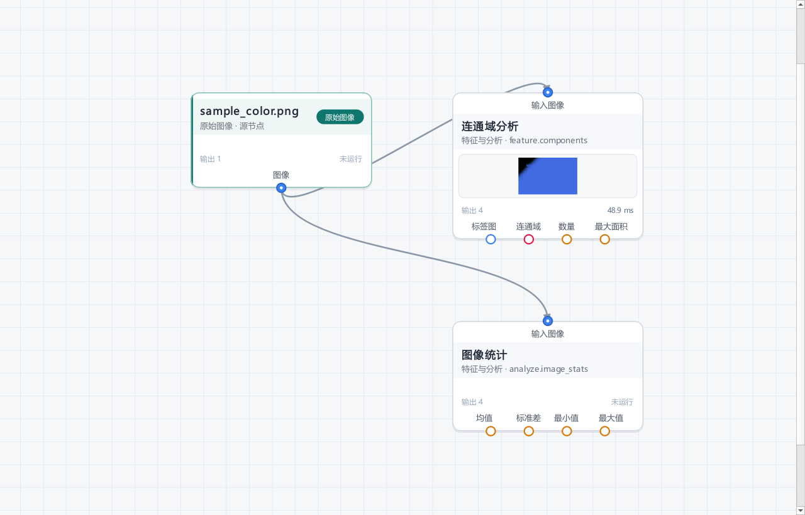

# MineImage 算子编写指南

本指南面向想给 MineImage 增加图像处理算子的开发者。读完可以做到：

* 写一个 `.py` 文件放进 `operators/`，重启或按 **F5** 后出现在左侧算子库；
* 用声明式 `OperatorSpec / PortSpec / ParamSpec` 自动生成参数界面与校验；
* 支持多输入 / 多输出、类型化端口（图像 / 数值 / 边缘特征 / 轮廓特征 /
  连通域）、数组 dtype 约定、参数联动与预览交互拾取；
* 知道常见错误如何定位。

> 本文以 MineImage 0.1.0（Python 3.13 / PySide6 6.10.1 实测）为准。
> 用户操作说明见 [user_guide.md](user_guide.md)，模块接口见
> [architecture.md](architecture.md)。

---

## 1. 五分钟写出第一个算子

在 `operators/` 下新建 `my_gain.py`（文件名不要以 `_` 开头）：

```python
from __future__ import annotations

import numpy as np

from app.operators.spec import Operator, OperatorSpec, ParamSpec


class Gain(Operator):
    spec = OperatorSpec(
        id="example.gain",
        name="增益",
        category=("其他", "示例"),
        description="把像素值乘以一个系数，用于快速调整亮度。",
        params=(
            ParamSpec("gain", "增益", "float", default=1.0, min=0.0, max=8.0, step=0.1),
        ),
    )

    def process(self, image=None, gain=1.0, **_):
        # 不要原地修改输入数组，返回新数组
        return np.clip(image.array.astype(np.float32) * gain, 0, 255).astype(np.uint8)


OPERATOR = Gain
```

保存后回到 MineImage：

1. 按 **F5**（或点算子库右上角的刷新按钮）重新扫描；
2. 左侧出现「其他 → 示例 → 增益」；
3. 把它拖进画布，连上原图输出端口即可预览。

文件必须能被 Python 正常导入，并在**模块级**定义 `OPERATOR`。`OPERATOR`
可以指向算子类（框架负责实例化），也可以直接是算子实例：

```python
OPERATOR = Gain          # 推荐：类
# OPERATOR = Gain()      # 也支持：实例
```

---

## 2. 自动发现规则

### 2.1 扫描哪些目录

`OperatorRegistry.build()` 会按以下顺序扫描：

| 顺序 | 目录 | 说明 |
| --- | --- | --- |
| 1 | `app/operators/builtin/` | 内置算子；设置里可关闭 |
| 2 | `<应用目录>/operators/` | 默认用户算子目录 |
| 3 | 设置中的额外目录 | **设置 → 算子目录 → 添加目录…**，可多个 |

* 打包成 exe 后，`<应用目录>` 是 exe 所在目录，即 `dist/operators/`。
* 额外目录写进 `.ini` 的 `operators/extra_dirs`，按列表顺序扫描。
* 只会扫描**目录**；路径不存在或不是目录会产生一条 warning，但不影响其它目录。

### 2.2 哪些文件会被加载

* 递归扫描 `*.py`；
* 文件名以 `_` 开头的文件会被跳过（例如 `_template.py`、`_utils.py`）；
* 路径中带 `__pycache__` 的会被跳过；
* **模块级 `OPERATOR` 注册一个算子**；也可以写 `OPERATORS = (A, B, ...)` 一次注册
  多个算子（内置目录 `app/operators/builtin/catalog/` 采用这个约定），两者可同时
  存在，但同一个模块内算子 `id` 不能重复。
* 没有 `OPERATOR` / `OPERATORS` 只产生 warning。
* 同一个算子 `id` 后扫描的会覆盖先扫描的（用户目录可以覆盖内置算子），并记录
  warning。覆盖是刻意支持的本地定制手段，不是报错。

扫描顺序决定覆盖关系：内置 → 默认用户目录 → 额外目录（按设置顺序）。

### 2.3 分类从哪来

1. `OperatorSpec.category` 非空时以它为准，例如 `("滤波与平滑", "高级")`；
2. 为空时，使用文件相对扫描根目录的文件夹路径：
   `operators/滤波/高级/双边.py` → `("滤波", "高级")`；
3. 仍为空时归入 `("其他",)`。

分类的**第一级**是算子库中整行折叠的分类分组（默认收起，可同时展开多个），
第二级及以后是折叠子分组（可逐级展开 / 折叠）。一级分类的常用顺序由
`app/core/constants.py` 的 `CATEGORY_ORDER` 决定，未知分类按名称排在后面：

`基础调整 / 滤波与平滑 / 阈值与分割 / 边缘检测 / 形态学 / 几何变换 / 通道与色彩 / 特征与分析 / 交互处理 / 其他`

### 2.4 刷新与热加载

* **F5** 或算子库右上角的刷新按钮：重新构建整个注册表，已打开的工作区会同步换用新注册表；
* 设置里勾选「监视算子目录变化」后，主窗口每 3 秒轮询一次文件 mtime/size，
  变化时自动刷新；
* 刷新不会改变画布上已有节点的参数；如果某个算子被删除或改名，打开其参数面板
  会退回画布，并在执行时报告“找不到算子”；
* 扫描失败被隔离到单个文件：**算子 → 查看加载日志…** 可看完整 traceback。

---

## 3. `OperatorSpec`：算子元数据

```python
OperatorSpec(
    id="filter.gaussian_blur",
    name="高斯模糊",
    category=("滤波与平滑",),
    description="……",
    version="1.0.0",
    author="MineImage",
    inputs=(PortSpec("image", "输入"),),
    outputs=(PortSpec("image", "输出"),),
    params=(ParamSpec("ksize", "核大小", "int", default=5),),
    keywords=("高斯", "gaussian", "模糊"),
    notes="补充说明，显示在算子说明浮层中。",
)
```

| 字段 | 类型 | 默认值 | 说明 |
| --- | --- | --- | --- |
| `id` | `str` | 必填 | 全局唯一，只允许字母、数字、`_`、`.`、`-`；建议 `分类.名称` |
| `name` | `str` | 必填 | 界面显示名称，不能为空 |
| `category` | `tuple[str, ...]` / `str` | `()` | 分类路径；字符串会用 `/` 或 `>` 拆分 |
| `description` | `str` | `""` | 一句话说明，显示在算子库浮层 |
| `version` | `str` | `"1.0.0"` | 供作者自用 |
| `author` | `str` | `""` | 供作者自用 |
| `inputs` | `tuple[PortSpec, ...]` | `(PortSpec("image", "输入"),)` | 至少可以没有输入（生成型算子） |
| `outputs` | `tuple[PortSpec, ...]` | `(PortSpec("image", "输出"),)` | **至少一个** |
| `params` | `tuple[ParamSpec, ...]` | `()` | 参数声明 |
| `keywords` | `tuple[str, ...]` | `()` | 参与算子库搜索 |
| `notes` | `str` | `""` | 说明浮层追加段落 |

构造时会校验：

* `id` 符合 `^[A-Za-z0-9_.-]+$`，且非空；
* `name` 非空；`outputs` 至少一个；
* 输入/输出端口 `key` 在各自集合内唯一且非空；
* 参数 `key` 唯一，且不能与输入端口 `key` 同名；
* 参数 `key` 不能叫 `self` / `kwargs` / `params`；
* 每个参数的默认值必须能通过该参数的类型/范围校验。

`category` 属性还有两个派生值：`tab`（第一级）和 `groups`（第二级起）。

---

## 4. `PortSpec` 与端口类型

### 4.1 端口字段

```python
PortSpec(
    key="image",
    label="输入",
    accepts=("L", "BGR", "BGRA"),
    optional=False,
    description="端口说明",
    data_type="image",       # 默认值，可省略
)
```

| 字段 | 默认值 | 说明 |
| --- | --- | --- |
| `key` | 必填 | `process()` 的关键字参数名 |
| `label` | 必填 | 界面显示名 |
| `data_type` | `DataType.IMAGE` / `"image"` | 端口数据类型，见 4.2；可写枚举或中英文别名 |
| `accepts` | `("L", "BGR", "BGRA")` | **仅图像端口**：允许的颜色空间；空元组表示任意 |
| `optional` | `False` | 未连接时是否允许执行 |
| `description` | `""` | 端口提示 |

`data_type` 是端口的唯一类型约束。未显式声明时端口是图像端口；**非图像端口
会忽略 `accepts`**（构造 `PortSpec` 时会清空为 `()`），不存在颜色空间校验。

颜色空间只有三种规范值：

* `L`：单通道灰度，数组形状 `(H, W)`；
* `BGR`：三通道，数组形状 `(H, W, 3)`，**通道顺序 B/G/R**（OpenCV 习惯）；
* `BGRA`：四通道，数组形状 `(H, W, 4)`，顺序 B/G/R/A。

`accepts_image()` 直接比较 `ImageData.color_space`。未连接且 `optional=True`
的输入在 `process()` 中收到 `None`；未连接的必填输入会在执行前报
`缺少输入：<label>`。

> 输出端口的 `accepts` 是给**下游连接检查**使用的声明，框架不会强制校验
> `process()` 实际返回的数组颜色空间；请自觉返回与声明一致的结果，否则下游
> 算子会报“需要 L 图像，当前为 BGR”之类的错误。

### 4.2 端口数据类型

`app/core/data_types.py` 的 `DataType` 是端口类型的唯一枚举来源。`PortSpec`
构造时会用 `coerce_data_type()` 归一化 `data_type`，因此既可以写枚举，也可以
写下列中英文别名（大小写不敏感、忽略首尾空白）：

| 类型 | `data_type` 取值 / 常用别名 | 运行时值容器 | 说明 |
| --- | --- | --- | --- |
| 图像 | `DataType.IMAGE`、`"image"`、`"img"`、`"图像"`、`"图片"` | `ImageData` | 默认类型；只有图像端口使用 `accepts` |
| 数值 | `DataType.NUMBER`、`"number"`、`"numeric"`、`"scalar"`、`"数值"`、`"数字"`、`"标量"` | `NumberValue` | 也可直接返回 `int` / `float` |
| 边缘特征 | `DataType.EDGES`、`"edge"`、`"edges"`、`"线段"`、`"边缘"`、`"边缘特征"` | `EdgesData` | 一组折线 / 线段 |
| 轮廓特征 | `DataType.CONTOURS`、`"contour"`、`"contours"`、`"轮廓"`、`"轮廓特征"` | `ContoursData` | 一组轮廓点，可带 `hierarchy` |
| 连通域 | `DataType.COMPONENTS`、`"component"`、`"components"`、`"connected_component"`、`"connected_components"`、`"连通域"`、`"连通分量"` | `ComponentsData` | 也可直接返回二维 int32 标签图 |

别名之外的取值会在声明阶段直接报错：

```text
不支持的端口数据类型：'xxx'；可选值：图像（image）、数值（number）、……
```

各类型对应的运行时值：

* **图像 → `ImageData`**：返回 `np.ndarray` 会被自动包装，形状 `(H, W)`
  推断为 `L`、3 通道为 `BGR`、4 通道为 `BGRA`；`(H, W, 1)` 会去掉单通道维。
* **数值 → `NumberValue(value, label="数值", unit="")`**：适合单个标量结果，
  `label` 用于摘要、`unit` 追加单位；也可直接返回 `int` / `float`（`bool` 不
  是合法数值，会报错）。`NumberValue.summary()` 生成“标签：值 单位”的一行文本。
* **边缘特征 → `EdgesData(segments, image_size=None, label="边缘线段")`**：
  `segments` 接受单个 `(N, 2)` 点数组、点数组元组 / 列表，或 `(K, N, 2)`
  数组；坐标统一取整为 int32。`image_size` 为 `(宽, 高)`，用于预览画布，
  省略时按点集包围盒推断。提供 `count`、`summary()`、`render_preview()`。
* **轮廓特征 → `ContoursData(contours, image_size=None, hierarchy=None, label="轮廓")`**：
  `contours` 的写法与边缘线段一致；`hierarchy` 与 OpenCV `findContours` 的
  层级数组一致（int32），可选。提供 `count`、`summary()`、`render_preview()`。
* **连通域 → `ComponentsData(labels, areas=(), centroids=(), image_size=None)`**：
  `labels` 必须是 `(H, W)` 二维标签图，**0 为背景**；`areas` / `centroids`
  省略时按标签自动统计。也可以直接返回 int32 二维标签图，框架会用
  `ComponentsData.from_labels()` 包装。提供 `count`、`total_area`、
  `largest_area`、`summary()`、`render_preview()`（按调色板渲染彩色标签图）。

这些容器都实现了 `summary()`，可被 `summarize_value()` 转为一行摘要；
`render_preview()` 可把非图像数据渲染成图像，仅供算子**显式**生成可视化输出，
引擎不再自动用它生成主预览或节点缩略图。

### 4.3 `process()` 签名

```python
def process(self, **kwargs):
    ...
```

引擎会把**所有声明的输入端口**和**所有参数**用关键字参数传进来：

* 输入按端口 `key` 命名，值类型为对应 `data_type` 的容器（`ImageData` /
  `NumberValue` / `EdgesData` / `ContoursData` / `ComponentsData`）或 `None`；
* 参数按 `ParamSpec.key` 命名，值已经过 `normalize_params()` 校验/转换；
* 建议末尾加 `**_` 或显式列出参数，避免以后新增参数时签名不匹配；
* 不要依赖 `self` 上的可变状态：同一个算子实例会被重复调用，并可能被多个后台
  线程同时调用（见第 11 节线程安全）。

可选覆写：

```python
def validate(self, inputs, params) -> None:
    """在执行前做跨端口/跨参数校验；失败时抛 OperatorError。"""
```

`validate()` 在输入齐全、颜色空间匹配、参数规范化之后调用，抛
`OperatorError` 会阻止执行并把消息显示在节点上。

### 4.4 返回值

`process()` 的返回值会经 `output_to_dict()` 按**输出端口的 `data_type`** 逐个
规范化（`coerce_output_value()`），再写入节点结果（`NodeResult.outputs`）。
可以返回：

1. 单个值：对应**第一个**输出端口；图像输出可以是 `np.ndarray`（自动包装为
   `ImageData`）或 `ImageData`；
2. `{output_key: value}`：多输出字典；`None` 表示该端口本次没有数据，会被跳过；
   未知 key 报“算子返回了未声明的输出端口：xxx”；
3. `list / tuple`：仅当声明了多个输出端口时可用，长度必须等于输出端口数量，
   按声明顺序映射。

每个端口可接受的返回值：

| 端口类型 | 可返回 | 规范化说明 |
| --- | --- | --- |
| 图像 | `ImageData` / `np.ndarray` | ndarray 按形状推断颜色空间；`(H,W,1)` 会去掉单通道维 |
| 数值 | `NumberValue` / `int` / `float` | 裸数值会包装为 `NumberValue`；`bool` 报错 |
| 边缘特征 | `EdgesData` / `(N,2)` 点集 / 点集列表 | 裸点集按默认标签包装为 `EdgesData` |
| 轮廓特征 | `ContoursData` / `(N,2)` 点集 / 点集列表 | 需要 `hierarchy` 时请直接构造 `ContoursData` |
| 连通域 | `ComponentsData` / 二维 int32 标签图 | 标签图 0 为背景，面积 / 质心自动统计 |

注意：

* 至少要有**一个**输出，否则报“算子没有产生任何输出”；
* 字典建议**显式写出所有输出 key**，不要依赖返回顺序；
* 返回值无法转换为端口类型时，引擎报 `输出“xxx”的数据无效：<原因>`，例如给
  数值端口返回字符串、点集形状不是 `(N,2)`、连通域不是二维标签图；
* 返回 `None` 会被视为错误；要“有条件输出”请用字典并省略 key（下游连接该端口
  时会报“上游节点未提供输出端口的数据”）；
* 预览主图只取第一个**图像**输出；没有图像输出时显示摘要文本，不再把边缘 /
  轮廓 / 连通域自动渲染成预览图。单个数值会直接显示在节点卡片内，数值 / 数组
  详情可在参数面板的「输出数据」区查看；
* 图像输出若没有命名，引擎会自动命名为 `节点标题:端口key`。

### 4.5 dtype 与数值约定

内置算子支持 `uint8`、`uint16`、`float32`；框架本身接受
`uint8/int8/uint16/int16/int32/float16/float32/float64/bool`。建议：

* 尽量保持输入的 dtype 和通道数；需要新数组时用 `astype(..., copy=...)`；
* 不要原地修改 `image.array`（预览、上游快照、撤销都与它共享数据）；
* 0–255 的参数在 uint16 图像上要乘以 257：`app.operators.builtin._utils`
  的 `full_scale()` / `scale_value()` 已封装该逻辑；
* 对 uint16/float32 做 `cv2.xxx` 前，先确认 OpenCV 支持该 dtype；否则先转
  `float32` 或 `uint8`（内置 `_utils.to_uint8()` / `native_array()` 可参考，
  但它们是内部辅助，签名可能变化）；
* 异常统一抛 `app.operators.spec.OperatorError("中文错误信息")`，框架会显示在
  节点和参数面板上；其它异常会被包装为“算子执行失败：异常类型: 消息”。

---

## 5. `ParamSpec`：参数声明

### 5.1 全字段

```python
ParamSpec(
    "ksize", "核大小", "int",
    default=5, min=1, max=99, step=2, odd=True,
    unit="px", group="参数", tooltip="必须为奇数",
    visible_when="params['mode'] == 'blur'",
    enabled_when="params['mode'] == 'blur'",
    count=0, interactive=None, multiline=False, placeholder="",
    widget="", layout="", widget_options={},
)
```

| 字段 | 类型 | 默认值 | 说明 |
| --- | --- | --- | --- |
| `key` | `str` | 必填 | 参数名；`^[A-Za-z_][A-Za-z0-9_]*$` |
| `label` | `str` | `key` | 界面标签；空字符串会退回 `key` |
| `type` | `str` | `"int"` | 见下方参数类型表 |
| `default` | `Any` | `None` | 为 `None` 时按类型使用内置默认值 |
| `min` / `max` | `float / None` | `None` | 数值范围；界面与校验共用 |
| `step` | `float / None` | `None` | 界面步长；float 默认 0.1，int 默认 1 |
| `choices` | `Sequence` | `()` | 仅 enum；支持 `(值, 标签)`、`{"value","label"}`、纯值 |
| `unit` | `str` | `""` | 单位后缀，如 `px`、`%` |
| `group` | `str` | `""` | 参数分组标题；空为「参数」 |
| `tooltip` | `str` | `""` | 鼠标提示 |
| `visible_when` | `str / None` | `None` | 联动表达式，False 时隐藏 |
| `enabled_when` | `str / None` | `None` | 联动表达式，False 时禁用 |
| `odd` | `bool` | `False` | 仅 int；要求奇数 |
| `count` | `int` | `0` | 仅 points；要求点数（0 表示不限） |
| `interactive` | `str / None` | `None` | 仅 points/roi/line；显式指定拾取工具 |
| `multiline` | `bool` | `False` | 仅 string；多行文本框 |
| `placeholder` | `str` | `""` | string/path/roi/line 的占位提示 |
| `widget` | `str` | `""` | 自定义控件注册名；仅非交互参数（见 5.4） |
| `layout` | `str` | `""` | 自定义参数行布局注册名；空为 `stacked`（见 5.4） |
| `widget_options` | `Mapping` | `{}` | 传给控件/布局工厂的只读配置副本，不参与校验 |

构造时校验：

* enum 必须提供 `choices`；
* `count` 只能用于 points，且不能为负数；
* `interactive` 只能用于 points/roi/line；
* 只有 points 可以使用 `count`；
* `widget` / `layout` 必须是合法注册名（字母、数字、下划线、点、连字符），且
  `widget` 不能用于 points/roi/line 交互参数；在可能被重复加载的算子模块里，
  注册时可传 `override=True` 避免“已注册”错误；
* `widget_options` 必须是映射，构造时会复制一份；
* 参数默认值会立即做一次类型/范围校验。

### 5.2 参数类型

| `type` | 界面控件 | 运行时值 | 校验与说明 |
| --- | --- | --- | --- |
| `int` | 数字框（范围大时带滑条） | `int` | 拒绝 bool、拒绝非整数 float；检查 min/max；`odd=True` 必须奇数 |
| `float` | 小数框 | `float` | 拒绝 bool；检查 min/max（1e-12 容差） |
| `bool` | 复选框 | `bool` | 接受 bool；数字转 bool；字符串 `true/1/yes/on` 与 `false/0/no/off/空` |
| `enum` | 下拉框 | `choices` 中的原值 | 必须与某个 choice 的 value **完全相等**；不会做字符串转换 |
| `string` | 单行/多行输入 | `str` | `multiline=False` 时去除首尾空白 |
| `color` | 颜色按钮 + 取色器 | `str` | `#RRGGBB` 或 `#RRGGBBAA`，统一转小写 |
| `path` | 文本框 + 浏览按钮（可用 `widget="model_file"` 换成模型下载控件） | `str` | 只做字符串处理，**不检查文件是否存在**；需要时在 process/validate 里检查 |
| `points` | 只读摘要 + 拾取/清除 | `list[[float, float]]` | 每个点必须 `[x, y]`；`count>0` 时数量必须精确匹配 |
| `roi` | 只读摘要 + 拾取/清除 | `list[float]`（4 项）或 `None` | `[x, y, w, h]`；宽高必须 > 0；不自动裁剪到图像范围 |
| `line` | 只读摘要 + 拾取/清除 | `list[float]`（4 项）或 `None` | `[x1, y1, x2, y2]`；是否重合由算子在 process 中判断 |

`default=None` 时的回退值：

| 类型 | 回退默认值 |
| --- | --- |
| `int` | `min`（若 `min > 0`），否则 `0` |
| `float` | `min`（若 `min > 0`），否则 `0.0` |
| `bool` | `False` |
| `enum` | 第一个 choice 的值 |
| `color` | `"#ffffff"` |
| `string` / `path` | `""` |
| `points` | `[]` |
| `roi` / `line` | `None` |

示例：

```python
ParamSpec("mode", "转换方式", "enum",
          choices=(("weighted", "加权平均"), ("average", "算术平均")),
          default="weighted")
ParamSpec("roi", "裁剪区域", "roi", default=None,
          placeholder="[x, y, w, h]",
          visible_when="params['enable_roi']")
ParamSpec("note", "备注", "string", default="", multiline=True)
ParamSpec("gain", "增益", "float", default=1.0, min=0.1, max=4.0,
          step=0.1, unit="×", group="增强")
```

### 5.3 隐藏参数也会参与校验和传递

`visible_when=False` 只影响界面显示。引擎每次执行都会：

1. `normalize_params(spec, node.params)`：**所有**参数（含隐藏参数）都要合法；
2. 把**所有**参数传给 `process()`。

因此隐藏参数的默认值/旧值必须始终合法，`process()` 也要能接受它们（通常只
在对应模式下读取）。不要依赖“隐藏参数就不会传进来”。

### 5.4 自定义控件与布局

参数面板支持算子作者在不修改 `app/ui/params.py` 的前提下替换某个参数的编辑器
或整行的排布方式。实现位于 `app/ui/param_widgets.py`：

| API | 用途 |
| --- | --- |
| `register_param_widget(name, factory, *, override=False)` | 注册 `ParamSpec.widget` 控件 |
| `register_param_layout(name, factory, *, override=False)` | 注册 `ParamSpec.layout` 行布局 |
| `ParamWidgetContext` | 控件工厂上下文：`param / panel / parent / options` |
| `ParamField(widget, getter, setter)` | 控件工厂返回值 |
| `ParamLayoutContext` | 布局工厂上下文：`param / panel / parent / label / field / options` |

内置名称：

* 布局 `stacked`（默认，标签在上）与 `inline`（标签在左，固定约 120px）；
* 控件 `model_file`：模型路径 + 浏览 + 后台下载 + 状态 + 官方下载地址。配置为
  `widget_options={"model": "<app.core.models.MODELS 中的 key>"}`；未知 key 只禁用
  下载，不抛异常。内置模型 key：`face_detection_yunet`、
  `face_recognition_sface`、`image_classification_mobilenetv2`（DNN 推理预置的
  MobileNetV2 分类模型）。

最小示例（放在算子模块或 UI 插件模块中；只在界面创建参数行时才会调用工厂）：

```python
from PySide6.QtWidgets import QHBoxLayout, QLineEdit, QWidget

from app.ui.param_widgets import (
    ParamField, ParamLayoutContext, ParamWidgetContext,
    register_param_layout, register_param_widget,
)

def line_widget(context: ParamWidgetContext) -> ParamField:
    line = QLineEdit(context.parent)
    line.setPlaceholderText(str(context.options.get("placeholder", "")))
    line.textChanged.connect(lambda _text: context.panel.notify_edited())
    return ParamField(
        widget=line,
        getter=line.text,
        setter=lambda value: line.setText("" if value is None else str(value)),
    )

def inline_row(context: ParamLayoutContext) -> QWidget:
    row = QWidget(context.parent)
    layout = QHBoxLayout(row)
    layout.addWidget(context.label, 0)
    layout.addWidget(context.field, 1)
    return row

register_param_widget("my.line", line_widget)
register_param_layout("my.inline", inline_row)

# 在算子声明中引用
ParamSpec("endpoint", "服务地址", "string", widget="my.line", layout="my.inline")
```

约定与注意事项：

* 工厂抛异常 / 返回无效对象 / 注册名不存在时，参数面板会回退到默认控件或
  `stacked` 布局，并在状态栏提示，不会导致整个面板崩溃；
* `getter()` 返回当前值，`setter(value)` 接收规范化后的新值（重置、撤销、拾取
  回填都会调用）；setter 内部应屏蔽控件自身信号，避免重复触发预览；
* 自定义控件只改变编辑方式，**不改变** `ParamSpec.type` 的校验与传给
  `process()` 的值类型；
* 下载 / 耗时操作应使用 `app.ui.model_download.start_model_download` 或其它后台
  机制，不要在控件工厂里阻塞；
* 算子模块被无界面环境加载时也可以注册工厂，但不要在模块顶层创建 Qt 控件。

---

## 6. 参数联动 `visible_when` / `enabled_when`

表达式由 `app.operators.spec.eval_condition()` 执行，环境是**受限 eval**：

* 可直接用参数名（裸变量）：`mode`、`otsu`、`points`；
* 也可用 `params['key']`：`params['mode']`；
* 可用 `params` 本身、`abs`、`len`、`min`、`max`；
* 不能使用 `import`、函数调用之外的其它内建函数、属性访问；
* 表达式异常时**静默视为 True**（保持可见/可用）。

```python
# 推荐：两种写法等价
visible_when="not otsu"
visible_when="params['otsu'] == False"

# 枚举/字符串
visible_when="mode == 'size'"
visible_when="params['mode'] == 'size'"

# 数值/长度
visible_when="len(points) >= 2"
visible_when="min(width, height) > 16"

# 组合
visible_when="not params['auto'] and params['mode'] != 'none'"
```

### 6.1 不支持属性访问（重要）

表达式**不支持** `params.otsu` / `params.mode` 这类属性写法：

```python
visible_when="not params.otsu"       # 错误：运行时 AttributeError
```

由于异常被吞掉并按 True 处理，效果是**永远可见**，不会报错提示，很难发现。
请统一使用裸变量名或 `params['x']`。

---

## 7. 交互参数：points / roi / line

参数面板对这三类参数显示只读摘要和「拾取」「清除」按钮，`process()` 直接拿到
坐标值：

| 类型 | 拾取工具 | 数据格式（图像坐标，左上角为原点） |
| --- | --- | --- |
| `points` | `points` | `[[x, y], ...]`，浮点 |
| `roi` | `rect` | `[x, y, w, h]`，浮点；`w/h > 0` |
| `line` | `line` | `[x1, y1, x2, y2]`，浮点 |

交互工具由 `ParamSpec.tool_name()` 决定：

* 默认映射：`points → points`、`roi → rect`、`line → line`；
* 也可以显式写 `interactive="points"/"rect"/"line"`，只对这三类参数合法。

### 7.1 用户在预览里怎么操作

进入参数面板后：

* **点集**：在右侧预览左键逐个添加；按 `Enter` 或右键完成；`Esc` 取消；
  若 `count>0`，必须凑满数量才能完成；
* **矩形**：在图像上按住左键拖出矩形，松开即完成；`Esc` 取消；
* **直线**：按住左键拖出线段，松开即完成；`Esc` 取消；
* 拾取结果会回填到参数并触发一次防抖预览（120ms）。

注意：

* 拾取基于**当前节点已计算出的结果图**，结果还没算完时状态栏会提示
  “请等待当前节点计算完成后再拾取”；
* 坐标是图像坐标，不是控件坐标；缩放/平移/对比模式下会自动做换算；
* 只有点/矩形/线支持拾取；`path` 默认只有文件浏览按钮，也可以给
  `ParamSpec.widget="model_file"` 增加后台下载与官方地址显示。

### 7.2 算子侧处理

```python
ParamSpec("points", "参考点", "points", default=[], count=3)
ParamSpec("roi", "裁剪区域", "roi", default=None)
ParamSpec("line", "标注线", "line", default=None)

def process(self, image=None, points=None, roi=None, line=None, **_):
    if roi:
        x, y, w, h = (float(v) for v in roi)
        if w <= 0 or h <= 0:
            raise OperatorError("矩形宽高必须大于 0。")
    if line:
        x1, y1, x2, y2 = (float(v) for v in line)
        if (x1, y1) == (x2, y2):
            raise OperatorError("线段端点不能重合。")
```

框架只校验数据结构（4 个数字、宽高 > 0、点数），**不会**替你判断点是否在图像
内、线段是否越界。越界处理由算子负责（可以裁剪、也可以抛错让用户重选）。

---

## 8. 多输入与多输出

### 8.1 多输入

```python
inputs=(
    PortSpec("b", "蓝色通道 (B)", accepts=("L",)),
    PortSpec("g", "绿色通道 (G)", accepts=("L",)),
    PortSpec("r", "红色通道 (R)", accepts=("L",)),
    PortSpec("alpha", "Alpha（可选）", accepts=("L",), optional=True),
)
```

* 每个输入在 `process()` 中按 key 接收；必填未连接 → 执行前失败；
* 可选输入未连接 → `None`；
* 一个输入端口只能接一条线；画布上连到已占用输入会替换旧连线；
* 多输入算子可以连接同一个上游的多个不同输出端口（内置“通道合并”就是这样
  接“通道拆分”的 B/G/R 三路），图模型不会把它误判为环路。

### 8.2 多输出

多输出节点的每个输出端口都有自己的 `data_type`（图像是默认值，可省略）。下面
示例同时输出 **图像 + 边缘特征 + 数值**（与内置「边缘特征」算子同类）：

```python
from app.core.data_types import DataType, EdgesData, NumberValue
from app.operators.spec import Operator, OperatorSpec, PortSpec


class EdgeFeature(Operator):
    spec = OperatorSpec(
        id="example.edge_feature",
        name="边缘特征（示意）",
        category=("特征与分析",),
        outputs=(
            PortSpec("edges", "边缘图", accepts=("L",)),
            PortSpec("lines", "边缘线段", data_type=DataType.EDGES),
            PortSpec("count", "线段数", data_type=DataType.NUMBER),
        ),
    )

    def process(self, image=None, **_):
        ...
        return {
            "edges": edge_map,                                   # ndarray → ImageData
            "lines": EdgesData(segments, image_size=(width, height)),
            "count": NumberValue(len(segments), label="线段数", unit="条"),
        }
```

* 输出端口在节点底部**按声明顺序水平排列**，每个端口有独立圆点和标签；
  圆点颜色按数据类型区分（`DataType.color`）；
* 每种类型只能连接到**同类型**的输入端口，端口类型不匹配时画布拒绝创建连线；
* 预览主图只取第一个**图像**输出；没有图像输出时不再自动渲染结构化数据，
  节点显示数值或「数组数据」提示，详情在参数面板查看；
* 节点摘要按 `端口标签（类型）：摘要` 生成（`NodeResult.summary_lines()` /
  `summary_text()`），多个输出之间用「；」拼接；
* 推荐用字典并显式写出所有输出 key；
* 也可以返回 `(edge_map, lines, count)`，但顺序必须与 `outputs` 完全一致；
* `dict` 中值为 `None` 的端口会被省略；
* 声明了输出但没返回，连接该端口的节点会收到“上游节点未提供输出端口的数据”。

下图是「连通域分析」（图像 + 连通域 + 数值 ×2）与「图像统计」（数值 ×4）
的多输出端口效果：端口位于节点底部，按声明顺序排列，圆点颜色区分数据类型。



### 8.3 连线类型校验

* 新建连线时，画布用 `port_types_compatible(output_port, input_port)` 判断：
  任意一端声明为万能端口（`any_type=True`）时直接兼容；否则两端 `data_type`
  必须**完全一致**；
* 图像端口还会检查颜色空间：双方都声明了 `accepts` 时必须有交集，任一方为空
  视为不限；实际像素的颜色空间在执行时再由 `validate_inputs()` 校验一次；
* 不满足时拒绝连线，并显示 `connection_error()` 生成的提示，例如
  `数据类型不匹配：输出“边缘线段”（边缘特征）不能连接到输入“输入”（图像（BGR））。`；
* 执行阶段还有兜底校验：`输入“xxx”需要数值数据，当前为图像。`，或
  `输入“xxx”需要 L/BGR 图像，当前为 BGRA。`；
* 旧的 `.mi` 工程仍可正常打开，已有连线原样保留；只有**新建 / 重新连线**时才
  做类型校验。

### 8.4 万能端口与节点显示策略

如果希望一个端口同时接收 / 输出任意已知类型，使用 `any_type=True`：

```python
from app.operators.spec import Operator, OperatorSpec, PortSpec

class Output(Operator):
    spec = OperatorSpec(
        id="example.output",
        name="输出",
        category=("其他", "可视化"),
        inputs=(PortSpec("data", "任意数据", any_type=True),),
        outputs=(PortSpec("data", "任意数据", any_type=True),),
    )

    def process(self, data=None, **_):
        return data
```

* 万能输入在 `validate_inputs()` 中只校验“值是已知数据类型”，不限定具体哪一种；
* 万能输出在 `coerce_output_value()` 中原样返回输入对象，不复制、不转换；
* `PortSpec.data_type` 对万能端口只是 UI 占位（默认图像），画布端口使用中性色；
* 节点卡片会自动处理显示：单个数值直接显示数值，图像显示缩略图，数组显示
  「数组数据 / 双击查看」提示；
* 主预览与节点缩略图只取图像输出，结构化数据不再自动调用 `render_preview()`；
  参数面板在结果包含非图像输出时自动显示「输出数据」区，以文本形式给出数组的
  数量、画布尺寸、形状、前几个点等详情；
* `render_preview()` 保留给算子**显式**生成可视化输出（例如连通域分析的彩色标签图），
  不再参与节点预览 / 缩略图的自动回退。

---

## 9. 完整可复制示例

下面这个算子覆盖：双输入、双输出、可选输入、enum/bool/int/color/roi 参数、
`visible_when` 的两种写法。保存为 `operators/threshold_overlay.py` 即可使用。

```python
from __future__ import annotations

from typing import Any

import cv2
import numpy as np

from app.operators.spec import Operator, OperatorError, OperatorSpec, ParamSpec, PortSpec


def _to_bgr_u8(array: np.ndarray) -> np.ndarray:
    if array.dtype != np.uint8:
        work = array.astype(np.float32)
        if array.dtype == np.uint16:
            work /= 257.0
        else:
            low, high = float(np.nanmin(work)), float(np.nanmax(work))
            if low >= 0.0 and high <= 1.0:
                work *= 255.0
            elif high > low:
                work = (work - low) / (high - low) * 255.0
        array = np.clip(np.rint(work), 0, 255).astype(np.uint8)
    if array.ndim == 2:
        return cv2.cvtColor(array, cv2.COLOR_GRAY2BGR)
    if array.ndim == 3 and array.shape[2] == 4:
        return array[:, :, :3].copy()
    if array.ndim == 3 and array.shape[2] == 3:
        return array.copy()
    raise OperatorError(f"不支持的图像形状：{array.shape}")


def _hex_to_rgb(color: str) -> tuple[int, int, int]:
    text = str(color or "").lstrip("#")[:6]
    try:
        return int(text[0:2], 16), int(text[2:4], 16), int(text[4:6], 16)
    except (ValueError, IndexError) as exc:
        raise OperatorError(f"颜色值无效：{color!r}") from exc


class ThresholdOverlay(Operator):
    spec = OperatorSpec(
        id="example.threshold_overlay",
        name="示例：阈值叠加",
        category=("其他", "示例"),
        description=(
            "按阈值生成二值蒙版，并把高亮颜色叠加到原图上。支持可选蒙版输入，"
            "输出叠加图与二值蒙版，演示双输入/双输出与参数联动。"
        ),
        version="1.0.0",
        keywords=("示例", "阈值", "高亮", "mask", "overlay"),
        inputs=(
            PortSpec("image", "图像", accepts=("L", "BGR", "BGRA")),
            PortSpec("mask", "蒙版（可选）", accepts=("L",), optional=True),
        ),
        outputs=(
            PortSpec("image", "叠加图", accepts=("BGR",)),
            PortSpec("mask", "二值蒙版", accepts=("L",)),
        ),
        params=(
            ParamSpec(
                "mode", "判定方式", "enum",
                choices=(("above", "高于阈值"), ("below", "低于阈值")),
                default="above", group="阈值",
            ),
            ParamSpec(
                "threshold", "阈值", "int", default=128, min=0, max=255,
                step=1, group="阈值",
            ),
            ParamSpec(
                "use_roi", "限制在矩形内", "bool", default=False, group="阈值",
            ),
            ParamSpec(
                "roi", "矩形区域", "roi", default=None, group="阈值",
                visible_when="params['use_roi']",
                enabled_when="params['use_roi']",
                tooltip="勾选“限制在矩形内”后，在预览中框选区域。",
            ),
            ParamSpec(
                "color", "高亮颜色", "color", default="#ffb020", group="外观",
            ),
            ParamSpec(
                "opacity", "叠加不透明度", "float", default=0.6,
                min=0.0, max=1.0, step=0.05, group="外观",
            ),
        ),
    )

    def process(
        self,
        image=None,
        mask=None,
        mode: str = "above",
        threshold: int = 128,
        use_roi: bool = False,
        roi=None,
        color: str = "#ffb020",
        opacity: float = 0.6,
        **_: Any,
    ):
        if image is None:
            raise OperatorError("缺少图像输入。")

        bgr = _to_bgr_u8(image.array)
        gray = cv2.cvtColor(bgr, cv2.COLOR_BGR2GRAY)
        if mode == "above":
            binary = np.where(gray >= int(threshold), 255, 0).astype(np.uint8)
        elif mode == "below":
            binary = np.where(gray < int(threshold), 255, 0).astype(np.uint8)
        else:
            raise OperatorError(f"不支持的判定方式：{mode}")

        if use_roi:
            if not roi or len(roi) != 4:
                raise OperatorError("已勾选矩形限制，请先在预览中框选区域。")
            x, y, w, h = (int(round(float(value))) for value in roi)
            if w <= 0 or h <= 0:
                raise OperatorError("矩形宽高必须大于 0。")
            limit = np.zeros_like(binary)
            cv2.rectangle(limit, (x, y), (x + w, y + h), 255, -1)
            binary = cv2.bitwise_and(binary, limit)

        if mask is not None:
            mask_array = mask.array
            if mask_array.ndim == 3 and mask_array.shape[2] == 1:
                mask_array = mask_array[:, :, 0]
            if mask_array.shape != binary.shape:
                raise OperatorError(
                    f"蒙版尺寸 {mask_array.shape[1]}×{mask_array.shape[0]} 与图像 "
                    f"{binary.shape[1]}×{binary.shape[0]} 不一致。"
                )
            binary = cv2.bitwise_and(binary, (mask_array > 0).astype(np.uint8) * 255)

        red, green, blue = _hex_to_rgb(color)
        overlay = np.zeros_like(bgr)
        overlay[binary > 0] = (blue, green, red)
        strong = cv2.addWeighted(bgr, 1.0 - float(opacity), overlay, float(opacity), 0)
        result = np.where(binary[:, :, None] > 0, strong, bgr)
        return {"image": result, "mask": binary}


OPERATOR = ThresholdOverlay
```

更完整的交互参数示例（矩形 / 线段 / 点集三种模式、可选蒙版、参数分组）见
[examples/custom_operators/highlight.py](../examples/custom_operators/highlight.py)，
可以整文件复制到 `operators/` 使用。

---

## 10. 测试与调试

### 10.1 先做无界面自测

```python
from app.operators.loader import OperatorRegistry
from app.core.imageio import load_image

registry = OperatorRegistry.build(["operators"])   # 或你的额外目录
print(registry.issues)                              # 加载错误/警告
entry = registry.entry("example.threshold_overlay")
assert entry is not None

image = load_image("sample_images/sample_color.png")
output = entry.operator.process(image=image, threshold=100, mode="above", **_)
print(output["mask"].shape, output["mask"].dtype)
```

`OperatorRegistry.build()` 只依赖 QtCore，可在普通单元测试中运行；把算子放到
临时目录即可隔离测试。

### 10.2 界面里的调试顺序

1. **算子不出现** → F5 → 「算子 → 查看加载日志…」；
2. **节点一执行就报错** → 选中节点看右侧错误文案；参数面板若有行内红字，先修参数；
3. **参数面板保存按钮变灰** → 底部红色校验信息；常见是 ROI 宽高为 0、点数不足、
   颜色格式不对；
4. **参数不生效** → 隐藏参数仍然会被传入，确认 `process()` 是否在对应分支读取；
5. **下游不更新** → 参数预览与保存都会递归更新全部下游；若仍没变，先看下游节点
   是否报错（上游执行失败 / 缺少输入 / 参数错误），再看 **帮助 → 日志** 与状态栏提示；
6. **性能** → 一次请求按 DAG 拓扑序把互不依赖的分支并行执行，worker 数可在
   **设置 → 常规 → 后台计算 → 并行线程数** 调整（`execution/workers`，默认
   min(4, CPU 核数)，范围 1–16）；避免不必要的大数组复制，必要时先缩小再处理。

### 10.3 常见错误对照

| 现象 / 日志 | 原因与处理 |
| --- | --- |
| `模块未定义 OPERATOR，已跳过` | 文件没有模块级 `OPERATOR`，或写在了函数内 |
| `OPERATOR 必须是 Operator 的子类或实例` | 指向了错误的类 |
| `算子类缺少 OperatorSpec 类型的 spec 属性` | `spec` 不是类属性 / 类型不对 |
| `算子必须实现 process()` | 忘记覆写 `process` |
| `非法算子 id` | id 含中文、空格、`/` 等 |
| `参数 key 与输入端口同名` | 改名参数或端口 |
| `参数 xxx 的默认值非法` | 默认值超范围 / enum 不在 choices / ROI 宽高 ≤ 0 |
| `Illegal instruction`/导入错误 | 算子文件 import 了当前环境不存在的包 |
| `缺少输入：xxx` | 必填端口没连线 |
| `数据类型不匹配：输出“xxx”（边缘特征）不能连接到输入“yyy”（数值）。` | 两端 `data_type` 不一致；改用同类型端口，或修正算子的端口声明 |
| `不支持的端口数据类型：'xxx'` | `PortSpec.data_type` 写错；使用 4.2 表格中的枚举或别名 |
| `输入“xxx”需要 L 图像，当前为 BGR` | 端口声明与实际颜色空间不匹配 |
| `输入“xxx”需要数值数据，当前为图像。` | 上游输出类型与输入端口声明不符（常见于旧工程重新连线或手改 spec）；核对两端 `data_type` |
| `缺少输入图像：...` | 算子内部 `as_array(None)` 的提示；检查必填端口 |
| `算子没有产生任何输出` | `process` 返回 `None` / 空字典 |
| `输出“xxx”的数据无效：...` | 返回值无法规范化为端口类型；按 4.4 检查容器参数（点集形状、标签图维度、数值类型等） |
| `算子返回了未声明的输出端口：xxx` | 字典 key 不在 `outputs` 中 |
| 参数联动“永远可见” | 表达式用了 `params.xxx` 属性访问，异常被吞；改用裸名或 `params['xxx']` |
| `找不到算子“xxx”` | 刷新后算子被删除/改名；重新添加节点 |

---

## 11. 最佳实践

* **不要在 `process()` 里操作 Qt 控件、弹窗、`app.exec()` 或阻塞等待**：它在
  后台线程执行（同一请求内可能有多个线程并发），界面相关操作会崩溃或卡死。
* **不要原地修改输入数组**；返回副本或新数组。
* **所有用户可见错误用中文**，并说明怎么修（例如“请先在预览中框选 ROI”）。
* **默认值必须合法且安全**：打开参数面板不应立即报错。
* **隐藏参数保持合法**，避免切换模式时残留非法值。
* **端口/参数命名稳定**：工程文件保存的是参数 key 与端口 key，改名会破坏旧工程。
* **提供 `keywords`**，方便搜索；在说明浮层里写清输入/输出与使用步骤。
* **保持纯函数风格**：结果只依赖输入与参数，便于预览、撤销与复现。
* **大图先缩再算**：如需多尺度处理，先 `cv2.resize`，避免每个参数拖动都全分辨率重算。
* **注意线程安全**：`process()` 可能被多个后台线程并发调用，不得依赖算子实例上
  的可变状态（如 `self.cache`），也不得原地修改输入数组（同一输入可能被多个兄弟
  分支同时读取）；返回新数组，必要时使用局部变量。不要假设“只有一个后台线程”
  而省略锁或复用共享缓冲。

---

## 12. 算子组算子（GroupOperator）

算子组算子（GroupOperator）是把画布上的算子组保存成自定义算子后得到的一类特殊算子。它不实现图像处理
`process()`，而是携带一份可展开的内部图定义（`group_definition`）；从算子库拖入画布时，
画布会把它展开成「算子组 + 内部节点 + 连线」。用户操作见 [user_guide.md](user_guide.md)
第 8 节，模型与引擎实现见 [group_node.md](group_node.md)。

### 12.1 生成方式与限制

* 在画布上右键算子组 → **保存为新算子…**，输入名称；
* 默认写入用户算子目录的 `operators/custom/`；算子 id 为 `group.<slug>`，
  文件名形如 `group_<slug>.py`；重名时自动追加 `_2`、`_3`；
* 生成文件的 `OperatorSpec.category` 固定为 `("用户自定义算子",)`，显示在算子库最顶部；
* 名称不能为空，最多 64 个字符；组内**不能包含原始图像节点**；
* 生成文件**只保存数据**：内部节点的 `op_id` / 参数 / 连线，以及被引用自定义算子组的
  `group_ref`；不复制其它算子的实现，也不 `import` 它们。

`GroupOperator.process()` 固定抛出 `OperatorError`：

> 算子组算子不能作为普通算子直接执行；请把它从算子库拖入画布，内部节点会展开成算子组。

因此不要把算子组算子当成普通图像算子接入参数面板或直接调用 `process()`。

### 12.2 生成文件结构

生成文件是一个普通 Python 模块，模块级定义 `OPERATOR`：

```python
"""由算子组“我的预处理”保存的自定义算子，内部包含 3 个节点。

本文件由 MineImage「算子组 → 保存为新算子」自动生成。
内部节点以 operator id 的形式引用，不重复其它算子的实现代码；依赖的算子缺失时
本文件仍可正常加载，展开后的算子组内对应节点会显示为失效，可右键替换。
"""

import json

from app.core.data_types import DataType          # 只有端口类型不是待定时才会导入
from app.operators.group import GroupOperator
from app.operators.spec import OperatorSpec, PortSpec

# 实际文件中是一行紧凑 JSON；这里展开便于阅读
GROUP_DEFINITION = json.loads(r"""
{
  "format": "mineimage-group-definition",
  "version": 1,
  "name": "我的预处理",
  "inputs":  [{"key": "input_1", "label": "输入 1", "data_type": null}],
  "outputs": [{"key": "output_1", "label": "输出 1", "data_type": "image"}],
  "nodes": [
    {"id": "n1", "op_id": "filter.gaussian_blur", "title": "高斯模糊",
     "pos": [40.0, 80.0], "params": {"ksize": 5}, "parent_group": null}
  ],
  "connections": [
    {"src_node": "__group__", "src_port": "input_1", "dst_node": "n1", "dst_port": "image"},
    {"src_node": "n1", "src_port": "image", "dst_node": "__group__", "dst_port": "output_1"}
  ]
}
""")


class MyGroup(GroupOperator):
    spec = OperatorSpec(
        id='group.my_group',
        name='我的预处理',
        category=('用户自定义算子',),
        description='由算子组“我的预处理”保存的自定义算子，内部包含 3 个节点。',
        version='1.0.0',
        inputs=(
            PortSpec('input_1', '输入 1', any_type=True),
        ),
        outputs=(
            PortSpec('output_1', '输出 1', data_type=DataType.IMAGE),
        ),
    )
    group_definition = GROUP_DEFINITION


OPERATOR = MyGroup
```

要点：

* 文件里的端口声明来自保存时组的端口快照：待定端口用 `any_type=True`，已定类型用对应
  `data_type`；
* `group_definition` 是唯一的数据来源；不要同时在 `spec` 和定义里维护两套不同的端口；
* 生成文件只依赖 `app.operators.group` / `app.operators.spec`（以及需要时的
  `app.core.data_types`），因此被引用的算子缺失时仍能被扫描；
* 想复制生成文件当模板时，记得同时修改 `spec.id`、类名与 `GROUP_DEFINITION.name`，
  避免 id 冲突。

### 12.3 `group_definition` 结构

| 字段 | 类型 | 说明 |
| --- | --- | --- |
| `format` | `str` | 固定 `mineimage-group-definition`；缺省视为兼容 |
| `version` | `int` | 当前为 `1`；更高版本会拒绝加载 |
| `name` | `str` | 算子组显示名 |
| `inputs` / `outputs` | `list[dict]` | 边界端口：`key / label / data_type`；`data_type: null` 表示待定 |
| `nodes` | `list[dict]` | 内部节点，见下表 |
| `connections` | `list[dict]` | 连线：`src_node / src_port / dst_node / dst_port` |

`nodes` 条目：

| 字段 | 说明 |
| --- | --- |
| `id` | 本次定义内唯一的节点 id |
| `op_id` | 普通算子 id；嵌套手工算子组为 `__group__` |
| `title` | 节点标题 |
| `pos` | 相对算子组左上角的 `[x, y]` |
| `params` | 节点参数（JSON 友好结构） |
| `parent_group` | 所属定义节点 id；`null` 表示组的直接子节点 |
| `group` | 嵌套**手工算子组**的端口定义（`op_id = "__group__"` 时） |
| `group_ref` | 引用另一个自定义算子组；含 `operator_id / name / inputs / outputs` |

约定：

* 根算子组自身用哨兵 `__group__` 表示：作为 `src_node` 表示从组输入端口取数，
  作为 `dst_node` 表示写入组输出端口；
* `group_ref` 只保存引用与端口，不内联被引用算子的内部节点。加载时如果注册表里有该算子，
  会递归展开成嵌套算子组；没有则生成带相同端口的占位算子组；
* 节点位置是相对坐标；从算子库拖入时会整体平移到落点；
* 定义至少需要一个输出端口；单个节点 / 连线不合法时会被跳过，格式、版本或缺少输出等
  致命问题会报错并拒绝加载；
* 算子组内不允许保存原始图像节点；保存时会报错。

### 12.4 依赖缺失行为

生成文件不 import 依赖，因此 **依赖缺失不影响加载**：

1. 算子库照常出现该算子组算子；
2. 拖入画布后，缺失的普通算子节点显示「失效」徽标；
3. 缺失的 `group_ref` 引用会变成占位算子组，标题栏显示「依赖缺失」，端口按
   `group_ref` 中的快照保留；
4. 右键失效节点 / 占位算子组 → 「替换算子…」可选择其它普通算子；替换保留位置与所属算子组，
   尽量按端口类型重连旧连线，整次替换可撤销；
5. 替换列表排除算子组；已经展开的占位算子组不会因为后来补回依赖文件而自动升级，
   需要重新拖入或替换。

### 12.5 手工编写与调试

推荐流程：**先在界面里搭好算子组 → 保存为新算子 → 再按需复制 / 修改生成文件**。
手工编写时至少保证：

1. 模块级 `OPERATOR` 指向 `GroupOperator` 子类（或其实例）；
2. 类上有合法的 `spec`（id / name / 至少一个输出端口）与非空 `group_definition`；
3. `group_definition.nodes[].op_id` 与当前注册表中的算子 id 完全一致；
4. 组输出的内侧来源（`dst_node = "__group__"` 的连线）存在，否则组输出为空；
5. 数据类型与连线两端一致；不确定时先用 `GroupPort` 的待定端口。

无界面检查：

```python
from app.core.group import normalize_group_definition
from app.operators.loader import OperatorRegistry
from app.operators.group import materialize_group_operator

registry = OperatorRegistry.build(["operators/custom"])
print(registry.issues)

entry = registry.entry("group.my_group")
assert entry is not None
definition = normalize_group_definition(entry.operator.group_definition)
print(definition["nodes"], definition["connections"])

# 展开成节点 / 连线（不会写入图模型，可用于检查端口与依赖）
materialization = materialize_group_operator(registry, "group.my_group", pos=(0.0, 0.0))
print(materialization.group_node.group.inputs)
print([node.op_id for node in materialization.nodes])
```

常见问题：

| 现象 | 原因 / 处理 |
| --- | --- |
| 算子库中没有生成文件 | 文件名以 `_` 开头、模块没有 `OPERATOR`、语法错误或目录未被扫描；按 F5 并查看「算子 → 查看加载日志…」 |
| 拖入时报“找不到算子组” / “不是算子组” | 注册表条目缺失，或 `group_definition` 为空 / 不是字典 |
| 拖入后节点「失效」 | `group_definition.nodes[].op_id` 在当前注册表里不存在；安装依赖或右键替换 |
| 拖入后出现「依赖缺失」占位算子组 | `group_ref.operator_id` 指向的算子组算子不存在；补回文件后重新拖入，或替换 |
| 组输出为空 | 定义中没有 `dst_node = "__group__"` 的连线，或内部来源节点缺失 |
| 定义被跳过 / 端口异常 | 检查 `data_type` 是否为合法类型；非法类型会回退为待定 |
| 提示版本过高 | 用更新版本的 MineImage 打开，或把 `version` 降到当前支持的 `1` |
| 直接调用 `process()` 报错 | 算子组只能拖入画布展开，不能直接执行 |

### 12.6 分发与维护

* 分发算子组算子时，生成文件之外还需要它所引用的普通算子 / 自定义算子组文件；
  缺依赖时能加载，但功能不完整；
* 修改被引用的自定义算子的内部实现后，已经展开到画布的实例不会自动更新；重新从算子库
  拖入外层算子会按最新定义展开；
* 生成文件是普通用户算子文件，删除后算子库中的条目会消失；已经展开到画布的算子组
  不受影响，可以继续编辑；
* 建议给算子 id 与文件名保持稳定，工程文件记录的是节点引用的 op_id，改名会破坏旧工程；
* 生成文件的内容由「保存为新算子」维护，手工改动后请用 12.5 的方法自测。

---

## 13. 参考：内置算子清单

阅读内置源码是学习写法的最快途径（`app/operators/builtin/`，目录算子见
`app/operators/builtin/catalog/`）：

| id | 名称 | 一级分类 | 亮点 |
| --- | --- | --- | --- |
| `basic.brightness_contrast` | 亮度/对比度 | 基础调整 | 基准点线性调整 |
| `basic.grayscale` | 灰度化 | 基础调整 | enum + 保持 dtype |
| `basic.invert` | 反相 | 基础调整 | dtype 满量程 |
| `basic.lut` | 查找表（LUT） | 基础调整 | 分段参数 + `visible_when` |
| `filter.gaussian_blur` | 高斯模糊 | 滤波与平滑 | 奇数核 + 滑动条 |
| `filter.mean_blur` | 均值模糊 | 滤波与平滑 | 边界模式 |
| `filter.median_blur` | 中值模糊 | 滤波与平滑 | dtype 限制提示 |
| `threshold.fixed` | 固定阈值 | 阈值与分割 | dtype 换算 + Otsu |
| `threshold.adaptive` | 自适应阈值 | 阈值与分割 | 8 位灰度转换 |
| `edge.canny` | Canny 边缘 | 边缘检测 | 双阈值 |
| `edge.sobel` | Sobel 边缘 | 边缘检测 | float32 梯度 |
| `morph.erode` / `morph.dilate` | 腐蚀 / 膨胀 | 形态学 | 结构元素 |
| `morph.open` / `morph.close` | 开运算 / 闭运算 | 形态学 | 组合形态学 |
| `geom.resize` | 缩放 | 几何变换 | 分组联动 |
| `geom.rotate` | 旋转 | 几何变换 | 尺寸/角度 |
| `geom.flip` | 翻转 | 几何变换 | 枚举轴 |
| `channel.split` | 通道拆分 | 通道与色彩 | **三输出** |
| `channel.merge` | 通道合并 | 通道与色彩 | **三输入** |
| `analyze.image_stats` | 图像统计 | 特征与分析 | **四数值输出**（均值 / 标准差 / 最小 / 最大） |
| `feature.edges` | 边缘特征 | 特征与分析 | **图像 + 边缘特征 + 数值** 三输出 |
| `feature.contours` | 轮廓特征 | 特征与分析 | **图像 + 轮廓特征 + 数值** 三输出 |
| `feature.components` | 连通域分析 | 特征与分析 | **图像 + 连通域 + 数值 ×2** |
| `feature.draw_contours` | 轮廓绘制 | 特征与分析 | 轮廓特征输入 + 图像输出 |
| `interactive.roi_crop` | ROI 裁剪 | 交互处理 | roi 参数 + 边界裁剪 |
| `interactive.draw_line` | 画线标注 | 交互处理 | line + color 参数 |

内置算子共 27 个（另有 `app/operators/builtin/catalog/` 下 167 个 OpenCV 5.0 目录算子，
完整清单见 [opencv_catalog.md](opencv_catalog.md)）；模板见 `operators/_template.py`，
完整示例见 `examples/custom_operators/highlight.py`。
