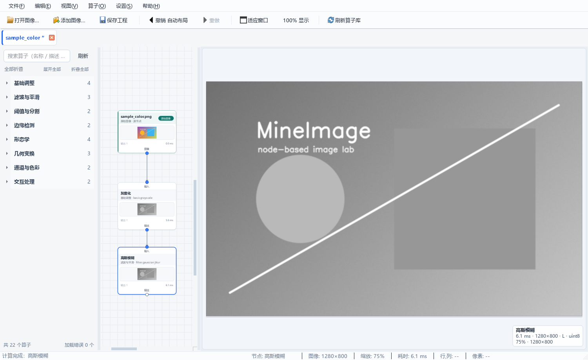
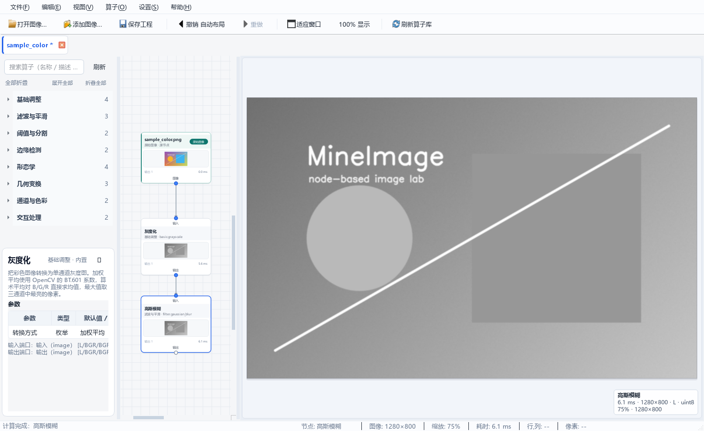
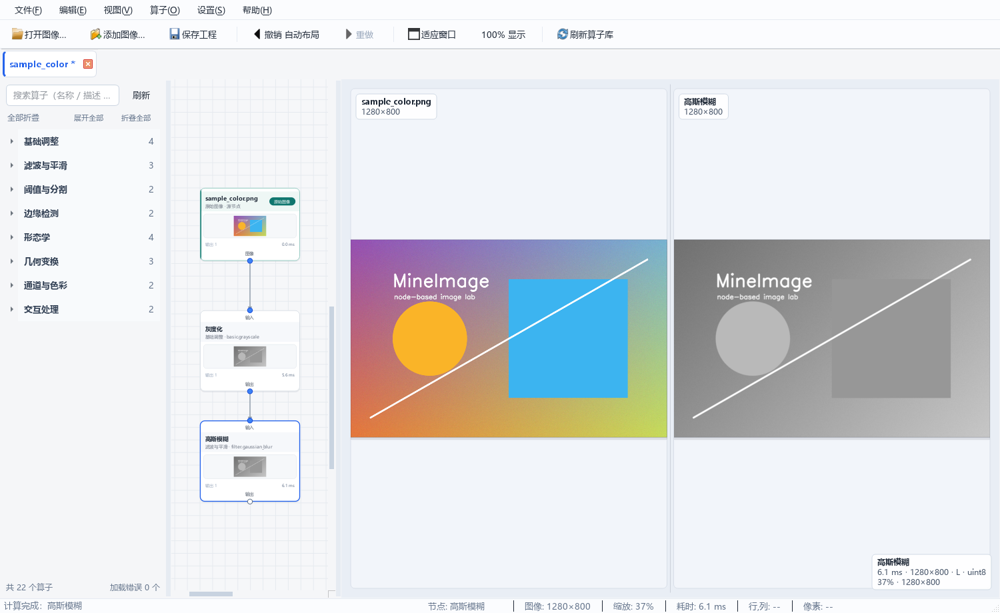
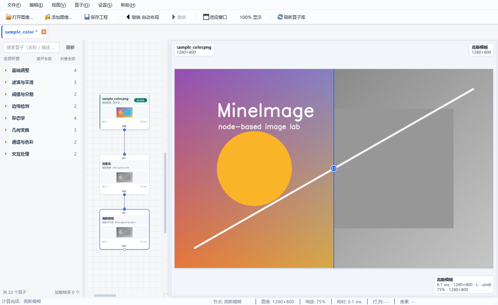
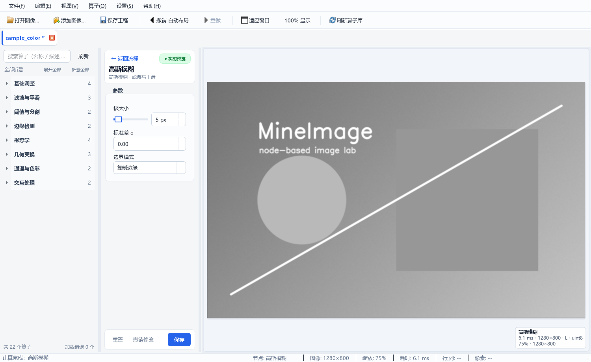

# MineImage 用户手册

MineImage 是一个基于 **PySide6 + OpenCV** 的节点式图像处理实验工作台。把左侧算子
拖进画布、连成流程，就能在右侧实时查看任意节点的中间结果，并沿着处理链逐段
排查效果。



---

## 1. 功能一览

* **节点画布**：拖拽算子、上下端口连线、靠近端口自动吸附连线、拖到连线上自动插入
  节点、Ctrl+C/V 复制粘贴节点、Ctrl+拖动框选、多分支 DAG、自动布局、撤销 / 重做。
* **算子库**：一级分类为整行折叠分组，默认全部收起、可同时展开多个；更深层级为
  多级折叠分组；支持搜索、拖拽、展开 / 折叠和单击查看算子说明浮层。
* **实时预览**：单击节点立即显示该节点输出；双击进入参数面板，拖动参数只重算
  当前节点，点击“保存”后才更新下游。
* **中间结果**：每个节点缓存自己的最新结果，随时点击查看；工程保存时参数与
  连线一并保存。
* **预览交互**：保持比例、`Ctrl+滚轮` 缩放、左键拖动、单视图 / 左右对比 /
  滑动对比；支持点选、矩形 ROI、画线工具供算子使用。
* **状态栏**：行/列坐标（左上角为原点）、原始像素值与 dtype、缩放比例、
  图像尺寸、当前节点、处理耗时。
* **自动发现算子**：把符合规范的 `.py` 文件放进 `operators/` 或设置中的额外
  目录，按 **F5** 即可刷新。
* **工程文件**：`.mi` 是 zip 容器，内嵌源图像（npz，保真 uint16/float32/alpha），
  换机器打开不丢图。
* **设置持久化**：`config/MineImage.ini`（便携式）。

---

## 2. 安装与启动

### 2.1 从源码运行

要求：Windows / macOS / Linux 桌面环境，Python 3.10+（开发验证 3.13），
PySide6 >= 6.6，NumPy、opencv-python、Pillow。

```powershell
python -m pip install -e .
python -m app
```

国内网络安装缓慢时，可给 pip 加镜像源，例如：

```powershell
python -m pip install -e . -i https://pypi.tuna.tsinghua.edu.cn/simple
```

### 2.2 使用打包版

`packaging/build_exe.ps1` 会生成单文件 `dist/MineImage.exe`。双击启动即可，
第一次启动需要解包，可能比源码运行慢几秒。也可以在命令行打开文件：

```powershell
dist\MineImage.exe --open "D:\images\demo.png"
```

或把 `.png` / `.mi` 文件路径直接作为第一个参数传给 exe（拖到 exe 图标上）。

### 2.3 日志与配置文件

启动时会写日志：

* 配置：`<应用目录>\config\MineImage.ini`
* 日志：`<应用目录>\config\MineImage.log`

源码运行时 `<应用目录>` 是仓库根目录；打包版是 `MineImage.exe` 所在目录。
如果应用目录不可写（例如装在 `Program Files`），配置会回退到系统配置目录，
具体路径可在 **设置 → 算子目录** 底部“配置文件”看到。

也可以用环境变量指定配置文件：

```powershell
$env:MINEIMAGE_CONFIG = "D:\mineimage\config\MineImage.ini"
python -m app
```

---

## 3. 主界面


| 区域 | 说明 |
| --- | --- |
| 菜单栏 | 文件 / 编辑 / 视图 / 算子 / 设置 / 帮助 |
| 工具栏 | 打开图像、添加图像、保存工程、撤销/重做、适应窗口、100% 显示、刷新算子库 |
| 标签栏 | 每个工作区一个标签；带 `*` 表示有未保存修改；标签可拖动排序、可关闭 |
| 左侧算子库 | 搜索框、整行折叠的一级分类、多级折叠树、算子说明浮层、底部算子数量/加载错误 |
| 中间画布 | 节点与连线；双击节点切换到参数面板；右侧留出大块预览区 |
| 右侧预览 | 当前节点结果 / 原始图像对比、缩放平移、像素拾取 |
| 底部状态栏 | 操作提示、节点、图像尺寸、缩放、耗时、行列坐标、像素值 |

打开图像后三栏默认约 **1:2:4**（算子库 : 画布 : 预览）；拖动分隔条可以调整，
下次打开同一工作区时会恢复上次的宽度。

---

## 4. 工作区与标签页

启动后如果没有打开任何文件，会先显示欢迎页，提供「打开图像」「打开工程」
「新建工作区」三个入口。

| 操作 | 菜单 / 快捷键 | 行为 |
| --- | --- | --- |
| 新建工作区 | 文件 → 新建工作区，`Ctrl+N` | 新建空白标签页 |
| 打开图像… | 文件 → 打开图像，`Ctrl+O` | **新建**一个标签页，并创建“原始图像”节点 |
| 添加图像… | 文件 → 添加图像，`Ctrl+Shift+O` | 把图像**追加到当前工作区**；没有工作区时先新建 |
| 打开工程… | 文件 → 打开工程，`Ctrl+Alt+O` | 打开 `.mi`，每个工程一个标签 |
| 最近打开 | 文件 → 最近打开 | 重新打开最近使用的图像或 `.mi` 工程（最多 10 个） |
| 关闭当前标签 | 文件 → 关闭当前标签，`Ctrl+W` | 有未保存修改时询问保存 |
| 退出 | 文件 → 退出，`Ctrl+Q` | 逐个询问未保存的工作区 |

要点：

* **“打开图像”和“添加图像”不一样**：前者新建标签（一条新流程），后者把图像
  加到当前流程，方便做多图对比或多源处理。
* 标签标题后的 `*` 表示自上次保存以来有修改；窗口标题也会显示。
* 关闭有修改的标签或退出时，会弹出“未保存的修改”对话框，可选择保存 / 不保存 /
  取消。
* 同一个工作区内可以有多张源图像，每个源图像是一个独立节点。
* 也可以把图像文件从资源管理器直接拖到画布上，等价于“添加图像”。

---

## 5. 打开图像与图像格式

支持的扩展名（文件对话框）：

`.png` `.jpg` `.jpeg` `.bmp` `.tif` `.tiff` `.webp` `.ppm` `.pgm` `.npy`

* 读取时优先用 OpenCV `IMREAD_UNCHANGED`，尽量保留 16 位、float 和 alpha；
  失败时回退 Pillow。`.npy` 直接读取 NumPy 数组，适合 float32 数据交换。
* 彩色图像在内部按 **BGR / BGRA** 存储，灰度按 `(H, W)` 存储；界面显示和状态栏
  会转换/标注。
* 打开图像会创建“原始图像”节点，节点上显示文件名和缩略图。
* 如果文件损坏或格式不支持，会弹出错误对话框；通过“打开图像”创建的临时标签
  会自动关闭。

示例图像可以运行 `python scripts/make_samples.py` 生成到 `sample_images/`。

---

## 6. 算子库（左侧）

### 6.1 查找与查看说明

* 一级分类是算子库中的**整行折叠标题**（左侧箭头 + 分类名 + 右侧算子数量）。
  默认全部收起；点击任意一行就在该行下方原地展开算子列表，下方分类标题整体
  下移。支持**同时展开多个分类**，互不影响。
* 分类内部保留多级折叠分组：二级、三级分类可以继续逐级展开 / 折叠；点击一级
  分类时会直接展开到算子，之后仍可单独收起任意分组。
* 顶部“展开全部 / 折叠全部”可一次操作整棵树。
* 顶部搜索框支持按 **名称、算子 id、描述、分类、关键字** 过滤；命中项会自动
  展开并在列表中定位。
* 单击算子名称会在库底部弹出说明浮层：名称、分类、内置/用户、描述、
  参数表（参数 / 类型 / 默认值 / 范围）、输入/输出端口及其数据类型 / 图像颜色空间。



按 `Esc` 或点击浮层外部关闭。

### 6.2 拖入画布

* 从算子库把一个算子拖到画布空白处，会创建一个节点；
* 拖到某个节点**端口附近**松手，会自动建立连接：
  靠近输出端口 → 新节点接在该输出之后（放在下方）；靠近输入端口 → 新节点的
  输出接在该输入之前（放在上方）。落点会自动对齐端口，间距约 48px；
* 拖到已有连线上，会直接把该节点插入这条连线（自动接好输入/输出并重新布局）；
* 目标输入端口已有连线时不会替换旧线，只在状态栏提示；
* 底部显示算子总数和“加载错误”数量；加载失败不会影响其它算子。

### 6.3 刷新与用户算子

* **F5** 或算子库右上角「刷新」重新扫描所有算子目录；
* **算子 → 打开用户算子目录** 会打开 `operators/`；
* **算子 → 查看加载日志…** 显示每个加载失败文件的完整 traceback；
* 自定义算子写法见 [operator_guide.md](operator_guide.md)。

> 安全提示：算子文件会在应用进程内执行任意 Python 代码，只放可信来源的文件。

---

## 7. 节点画布操作

| 操作 | 效果 |
| --- | --- |
| 单击节点 | 选中并预览该节点结果（延迟约 220ms 判定单击/双击） |
| 双击节点 | 进入参数面板（源图像节点没有参数，会提示） |
| 拖动节点 | 移动位置；移动会进入撤销栈，但纯位置变化不会触发节点重算。靠近其它节点的端口松手会自动连线，拖到其它连线上松手会插入到中间 |
| `Ctrl+C` / `Ctrl+V` | 复制选中的节点 / 在原地附近粘贴；副本之间的连线会一并复制，整次粘贴一步撤销 |
| 左键拖动空白处 | 拖动画布（平移视图） |
| `Ctrl+左键` 拖动空白处 | 框选节点/连线 |
| 从输出端口拖到输入端口 | 连线；输出端口在节点下边缘、输入端口在上边缘，连到已占用输入会替换旧连线 |
| 拖动连线 / 选中连线后 Delete | 删除连线 |
| `Delete` / `Backspace` | 删除选中的节点和连线（整体一步撤销） |
| `Esc` | 取消正在拖出的连线、自动吸附提示；再按一次清空选择 |
| 右键节点 | 删除节点 / 重命名节点 / 自动布局 / 适应视图 |
| 右键空白 | 自动布局 / 适应视图 |
| 右键连线 | 删除连线 / 自动布局 / 适应视图 |
| `Ctrl+L` | 自动布局（纵向分层，父节点尽量对齐子节点） |
| `Ctrl+滚轮` | 缩放画布（15%–300%，以光标为锚点） |
| 滚轮 | 纵向滚动画布 |
| `Shift+滚轮` | 横向滚动画布 |
| 拖入图像文件 | 追加源图像节点 |

画布不显示滚动条，视觉上是一整块画布；平移 / 滚动全部通过鼠标拖动与滚轮完成。

端口方向：**输入端口在节点上边缘，输出端口在下边缘**，连线是纵向 S 形曲线。
拖动时靠近端口会高亮候选端口，靠近连线会高亮候选连线，松手即完成自动连接 /
插入；拖动现有节点时也会执行同样的吸附逻辑（多选整体移动时不自动连线）。

连线限制：

* 不能连接节点自身；
* 不能形成环路（当前版本只支持 DAG）；
* 同一个输入端口只能有一条连线；重复连接会提示或替换；
* 端口数据类型必须一致（图像 / 数值 / 边缘特征 / 轮廓特征 / 连通域），
  多输出节点底部会按声明顺序排列多个输出端口，每种类型有独立颜色；
* 端口颜色空间不匹配时，新建连线会被拒绝；执行阶段还会再校验一次
  （例如把灰度图接到只收 BGR/BGRA 的端口）。

节点上的小徽标/颜色表示状态：正常、计算中、失败（带错误消息）、缩略图等。
节点缩略图可以在 **设置 → 常规 → 节点缩略图** 关闭，以提升大图场景性能。

### 7.1 输出预览节点（其他 → 可视化）

「输出预览」是流程终点 / 中途检查点专用的节点：

* 五个输入端口都是**可选**的，分别接收图像、数值、边缘特征、轮廓特征与连通域；
* 节点预览会把所有已接入的数据汇总成一张显示面板：图像缩略图 + 数值卡片 +
  特征缩略图，因此只接数值或结构化数据时也有可看的预览；
* 除了面板之外，`image` / `number` / `edges` / `contours` / `components`
  五个输出端口会把输入**原样**透传，可以直接插在任意链路中而不改变数据；
* `display` 端口输出汇总面板本身，需要把面板继续接到下游时使用。

---

## 8. 右侧预览



### 8.1 三种视图

| 模式 | 菜单 / 快捷键 | 说明 |
| --- | --- | --- |
| 单视图 | 视图 → 单视图，`Ctrl+1` | 只显示当前节点结果 |
| 左右对比 | 视图 → 左右对比，`Ctrl+2` | 左：当前节点所在分支的源图像；右：当前结果 |
| 滑动对比 | 视图 → 滑动对比，`Ctrl+3` | 同一视图内左右分割；拖动中间手柄比较 |



“原始图像”是当前节点**所在分支最近的源图像**；如果找不到，就取工作区里的
第一张源图像。多源工作区里不同分支对比的基准可能不同。

### 8.2 缩放与平移

* `Ctrl+滚轮`：以光标为中心缩放（2%–6400%）；
* 左键拖动：平移（左右对比模式下不平移，只居中显示两幅图）；
* 视图 → 适应窗口，`Ctrl+9`；
* 视图 → 100% 显示，`Ctrl+0`；
* 底部状态栏实时显示当前缩放百分比。

### 8.3 像素信息

鼠标在预览上移动时，状态栏右侧显示：

```
行,列: 123, 456   |   像素: R=120  G=80  B=40 · uint8
```

* 行/列以图像**左上角**为原点；
* 像素值是**原始 dtype**（不是显示归一化后的值）；彩色按 R/G/B/A 顺序；
* 灰度显示 `Gray=...`；带 alpha 显示 `A=...`；
* 光标移出图像时显示 `--`。

### 8.4 交互拾取（点 / 矩形 / 线）

带交互参数的算子（如「ROI 裁剪」「画线标注」）在参数面板中显示「拾取」按钮：

* **点集**：左键逐点添加，`Enter` 或右键完成，`Esc` 取消；点数受参数 `count`
  限制；
* **矩形**：按住左键拖出矩形，松开完成；
* **直线**：按住左键拖出线段，松开完成；
* 拾取结果会回填参数并触发实时预览；坐标是图像坐标（左上原点）。

如果当前节点暂时还没有输出（例如默认参数会报错），拾取会自动回退到最近的
上游结果或源图像，因此仍可正常框选/画线；状态栏会给出对应提示。

---

## 9. 参数面板

双击画布节点进入参数编辑页（中间区域切换为参数面板，右侧预览保留）。
双击后右侧会立即显示该节点的结果：已有缓存直接显示，否则显示“正在计算…”并
在后台取回该节点输出；不会停留在上一个节点的画面上。



### 9.1 界面说明

* 顶部「← 返回流程」（`Esc`）回到画布；
* 右上角徽标：「实时预览」表示参数合法，修改会立即重算当前节点；
  「参数有误」表示校验失败；
* 参数按 `group` 分组显示；有联动的参数会自动隐藏/禁用；
* 底部按钮（中间栏较窄，按钮文案简短，悬浮可看完整说明）：
  * **重置**：恢复算子声明的默认参数；
  * **撤销修改**：恢复到刚打开面板时的参数；
  * **保存**：提交参数，并让**下游节点**失效重算。

### 9.2 “实时预览”与“保存”的区别（重要）

| 动作 | 计算范围 | 是否影响下游 |
| --- | --- | --- |
| 拖动滑条 / 修改参数 | 只重算**当前节点**（120ms 防抖） | 否 |
| 点击「保存」 | 当前节点提交，**下游整棵子树**失效并重算 | 是 |
| 点击「← 返回流程」/ 切到其它节点 | 结束本次参数编辑会话，合并为一步撤销 | 否（未保存的下游不重算） |
| 关闭标签 / 保存工程 | 保存的是当前内存中的参数值 | — |

所以调参时可以先只观察当前节点效果，满意后再「保存」更新整条链，避免大图
场景反复重算下游。

### 9.3 校验与联动

* 参数非法时，底部显示红色错误信息，**保存按钮禁用**；
* 例如 ROI 宽高为 0、点集数量不足、颜色格式错误、数值超范围等；
* `visible_when` / `enabled_when` 让参数随模式显示/隐藏或禁用；
* 隐藏参数仍然参与校验并传给算子，所以默认值必须合法。

### 9.4 交互参数

点集 / 矩形 / 直线参数显示只读摘要和「拾取」「清除」按钮；操作见
[8.4 交互拾取](#84-交互拾取点--矩形--线)。

---

## 10. 撤销与重做

* `Ctrl+Z` 撤销，`Ctrl+Y` 重做（编辑菜单里会显示具体动作名）；
* 进入撤销栈的操作：新增/删除节点、连线/断线、移动节点、自动布局、重命名、
  批量删除、参数编辑会话；
* 参数撤销是**会话粒度**：一次参数面板编辑（保存/返回/切换节点时）合并成一步，
  而不是每个滑条像素一步；
* 每个标签页有独立的撤销栈；
* 撤销步数上限在 **设置 → 常规 → 撤销步数** 配置（默认 100）；
* 撤销/重做后，引擎会清空快照并重算当前预览节点。

---

## 11. 状态栏

从左到右：

| 字段 | 内容 |
| --- | --- |
| 提示 | 最近一次操作/错误/后台计算提示 |
| 节点 | 当前预览节点标题 |
| 图像 | 当前结果宽×高 |
| 缩放 | 预览缩放百分比 |
| 耗时 | 当前节点最近一次计算耗时（毫秒） |
| 行,列 | 光标处图像坐标（左上原点） |
| 像素 | 光标处原始像素值 + dtype（R/G/B/A 或 Gray） |

没有选中节点或光标不在图像上时显示 `--`。

---

## 12. 工程文件 `.mi`

### 12.1 保存

* **文件 → 保存工程** `Ctrl+S`：首次保存会弹出文件对话框，之后直接覆盖；
* **文件 → 工程另存为…** `Ctrl+Shift+S`：选择新路径；
* **文件 → 导出当前节点图像…** `Ctrl+E`：把当前节点最新结果保存为
  PNG / TIFF / `.npy`（保留原始 dtype 与通道）；
* 保存后标签标题的 `*` 消失；工程名默认取文件名；
* 保存会**清理未被任何源图像节点引用的图片**，避免工程无限膨胀。

### 12.2 文件结构

`.mi` 是一个 zip 容器：

```
project.json          # 格式名、版本、工作区名、节点/参数/连线
images/<image_id>.npz # 内嵌源图像数组（压缩）
```

* 源图像以 npz 内嵌，因此 **换机器打开不丢图**，不依赖原始图片路径；
* `project.json` 里仍记录原始路径，仅作信息展示；
* 支持 uint16 / float32 / alpha 无损往返；
* 当前格式版本为 1；更高版本创建的工程会提示无法打开。

### 12.3 打开

* **文件 → 打开工程…** `Ctrl+Alt+O`；也可以把 `.mi` 拖到 exe 或通过
  `--open` 参数打开；
* 工程会新建一个标签页；节点位置、参数、连线、工作区名都会恢复；
* 打开后会自动选中末端节点（sink）并显示其结果，画布也会尝试适应视图；
* 打开后处于“干净”状态（不显示 `*`）；
* 文件损坏、缺图、JSON 损坏会弹出错误对话框，不会覆盖当前工作区。

---

## 13. 设置

### 13.1 打开方式

**设置 → 首选项…**（`Ctrl+,`）。设置对话框分为「常规」「预览」「算子目录」三页，
点「确定」后立即保存并应用到所有打开的工作区。

### 13.2 常规

| 选项 | 说明 |
| --- | --- |
| 撤销步数 | 撤销栈上限（至少 1，默认 100） |
| 在节点上显示结果缩略图 | 关闭可提升大图场景性能 |
| 打开预览时自动适应窗口 | 尺寸变化/首次显示时自动 fit；关闭后保持 100% 或手动缩放 |

### 13.3 预览

| 选项 | 说明 |
| --- | --- |
| 启用预览降采样 | **只影响屏幕显示**，不改变缓存/计算结果 |
| 最大显示边长 | 降采样后最长边像素数（至少 256，默认 2048） |
| 在状态栏显示光标处像素值 | 关闭后状态栏不再显示像素值（行列坐标仍显示，像素列显示 `--`） |

### 13.4 算子目录

| 选项 | 说明 |
| --- | --- |
| 用户算子目录列表 | 额外扫描目录；可添加/移除 |
| 启用内置算子目录 | 关闭后只剩用户算子 |
| 监视算子目录变化 | 每 3 秒检查 mtime/size，变化时自动刷新 |
| 配置文件 | 显示当前 `.ini` 路径，可打开所在文件夹 |

### 13.5 `.ini` 主要键

`AppSettings` 读写以下键（节/键名）：

| 键 | 默认 | 说明 |
| --- | --- | --- |
| `general/undo_limit` | 100 | 撤销步数 |
| `general/node_thumbnails` | true | 节点缩略图 |
| `general/node_thumbnail_size` | 72 | 缩略图边长（32–96，界面未暴露，可手改） |
| `preview/auto_fit_on_open` | true | 打开/尺寸变化时自动适应 |
| `preview/downsample` | false | 预览降采样 |
| `preview/downsample_max_dim` | 2048 | 降采样最长边 |
| `preview/cursor_pixel_info` | true | 状态栏像素信息开关（关闭后像素显示 `--`，行列仍保留） |
| `operators/extra_dirs` | [] | 额外算子目录列表 |
| `operators/builtin_enabled` | true | 内置算子 |
| `operators/watch` | false | 监视目录变化 |
| `window/geometry` / `window/state` | — | 窗口位置/工具栏状态（自动保存） |
| `window/workspace_sizes` | [200, 400, 800] | 三栏宽度（关闭标签时保存，默认 1:2:4） |
| `files/recent` | [] | 最近文件（最多 10 个，可在“文件 → 最近打开”中重新打开） |

> 直接编辑 `.ini` 后需要重启应用；通过设置对话框修改会立即生效。
> 注意不要手工写入非法类型，例如把布尔值写成无法识别的字符串。

---

## 14. 自定义算子

1. 打开 `operators/`（**算子 → 打开用户算子目录**）；
2. 复制 `_template.py` 为 `my_op.py`（文件名不要以 `_` 开头）；
3. 修改 `OperatorSpec` 的 id/名称/分类/参数与 `process()`；
4. 回到 MineImage，按 **F5**；
5. 在左侧对应分类中找到它；加载失败时看 **算子 → 查看加载日志…**。

也可以把算子放到任意目录，然后在 **设置 → 算子目录** 添加该目录。子目录名会
自动成为分类；显式 `category` 优先。

完整字段、参数类型、联动、交互参数、多输入/输出与测试方法见
[operator_guide.md](operator_guide.md)。可复制的完整示例：

* `operators/_template.py`（最小模板）
* `examples/custom_operators/highlight.py`（双输入/双输出 + 三种交互参数）

> 算子文件在应用进程内执行，请只放可信来源的代码。

---

## 15. 快捷键总表

| 快捷键 | 功能 |
| --- | --- |
| `Ctrl+N` | 新建工作区 |
| `Ctrl+O` | 打开图像（新标签） |
| `Ctrl+Shift+O` | 添加图像到当前流程 |
| `Ctrl+Alt+O` | 打开工程 |
| `Ctrl+S` | 保存工程 |
| `Ctrl+Shift+S` | 工程另存为 |
| `Ctrl+E` | 导出当前节点图像 |
| `Ctrl+W` | 关闭当前标签 |
| `Ctrl+Q` | 退出 |
| `Ctrl+Z` / `Ctrl+Y` | 撤销 / 重做 |
| `Ctrl+C` / `Ctrl+V` | 复制 / 粘贴画布中选中的节点 |
| `Delete` / `Backspace` | 删除画布中选中的节点/连线 |
| `Esc` | 取消连线、清空选择、取消拾取、返回画布 |
| `F5` | 刷新算子库 |
| `Ctrl+,` | 首选项 |
| `Ctrl+1` / `Ctrl+2` / `Ctrl+3` | 单视图 / 左右对比 / 滑动对比 |
| `Ctrl+9` / `Ctrl+0` | 预览适应窗口 / 100% |
| `Ctrl+L` | 自动布局 |
| `Ctrl+滚轮` | 缩放画布（或预览） |
| 滚轮 | 纵向滚动画布 |
| `Shift+滚轮` | 横向滚动画布 |
| 左键拖动空白 | 拖动画布（平移视图） |
| `Ctrl+左键` 拖动空白 | 框选 |
| 左键拖动节点 | 移动节点 |
| 左键从端口拖出 | 连线 |
| 双击节点 | 打开参数面板 |
| 单击节点 | 选中并预览 |
| `Enter` | 完成点集拾取 |
| 预览中右键 | 点集拾取完成；矩形/直线拾取取消 |
| 右键节点/连线/空白 | 画布上下文菜单 |

---

## 16. 已知限制

1. **只支持 DAG**：不支持回环/循环；数据结构保留了扩展空间。
2. **撤销是会话/操作粒度**：参数面板内一次编辑合并为一步；不是逐键撤销。
3. **预览降采样只影响显示**：`preview/downsample` 不改变计算得到的像素与工程数据。
4. **导出只针对当前节点**：`Ctrl+E` 保存当前节点最新快照；暂不提供整条流程的批量导出。
5. **后台单线程计算**：耗时算子会阻塞后续预览任务；已经在执行的算子不会被强制
   中断（通过 generation 丢弃过期结果）。
6. **左右对比模式不支持平移**：该模式两幅图各自居中；需要仔细对比时可切到滑动
   对比或单视图。
7. **“最近打开”只保留最近 10 个路径**：删除/移动文件后菜单项会提示不存在。
8. **节点缩略图/超大图**：大分辨率 + 多节点时缩略图会拖慢画布，可在设置中关闭。

---

## 17. 故障排查

| 现象 | 排查 |
| --- | --- |
| 启动报 `No module named 'PySide6'` | 在项目目录执行 `python -m pip install -e .`；确认用的是同一个 Python |
| 启动报 Qt platform plugin | 重装 PySide6；Windows 桌面不要设置 `QT_QPA_PLATFORM=offscreen` |
| 中文显示为方框 | 确认系统有“微软雅黑”（Windows 默认有）；打包版在无中文字体的精简系统上可能缺字 |
| 打开图像失败 | 检查格式/文件是否损坏；`.npy` 必须是 2D/3D 图像数组；看弹窗错误 |
| 拖入图像没反应 | 只接受支持的扩展名；可改用“文件 → 添加图像” |
| 算子库为空/少了算子 | 按 F5；检查设置里的目录、文件名是否以 `_` 开头、模块是否有 `OPERATOR`；看加载日志 |
| 节点报“缺少输入” | 必填端口没连线；多输入算子要连齐（例如通道合并 B/G/R 三个） |
| 连线提示“数据类型不匹配” | 例如把“数值”输出接到“图像”输入；改为连接同类型端口，或选用带对应输入类型的算子 |
| 节点报颜色空间不匹配 | 例如把灰度图接到只收 BGR/BGRA 的端口；先接灰度化/通道合并调整 |
| 节点报“算子没有产生任何输出” | 算子 `process()` 返回了 `None`/空字典；看加载日志或算子代码 |
| “保存”按钮灰色 | 参数校验失败；看面板底部红色提示（ROI 宽高、点数、颜色格式等） |
| 预览一直“正在计算…” | 后台单线程，前面有耗时任务；等状态栏提示完成；必要时减少分辨率 |
| 参数改了但下游没变 | 这是设计：实时预览只算当前节点；点「保存」才更新下游 |
| 关闭时反复问保存 | 正常行为；可先 `Ctrl+S` 保存，或选择“不保存” |
| 工程打不开 | 文件损坏 / 版本过高 / 缺内嵌图像；错误对话框会说明；`.mi` 是 zip，可用解压工具检查 |
| 程序崩溃 | 查看 `<应用目录>/config/MineImage.log`；未捕获异常也会写日志并弹错误框 |

---

## 18. 相关文档

* [算子编写指南](operator_guide.md)
* [架构与模块边界](architecture.md)
* [第三方节点编辑器对比](third_party.md)
* `examples/README.md`：演示工程、截图脚本、自定义算子示例
